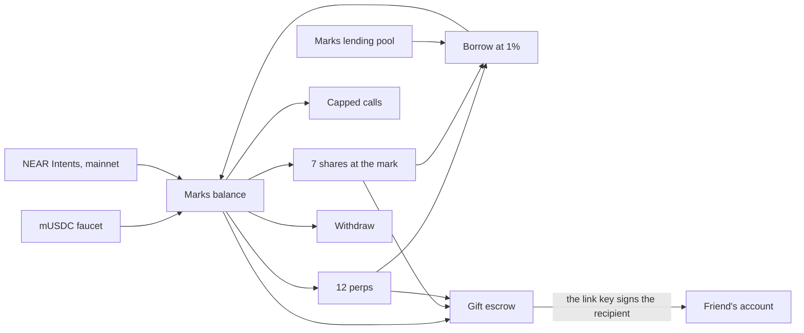
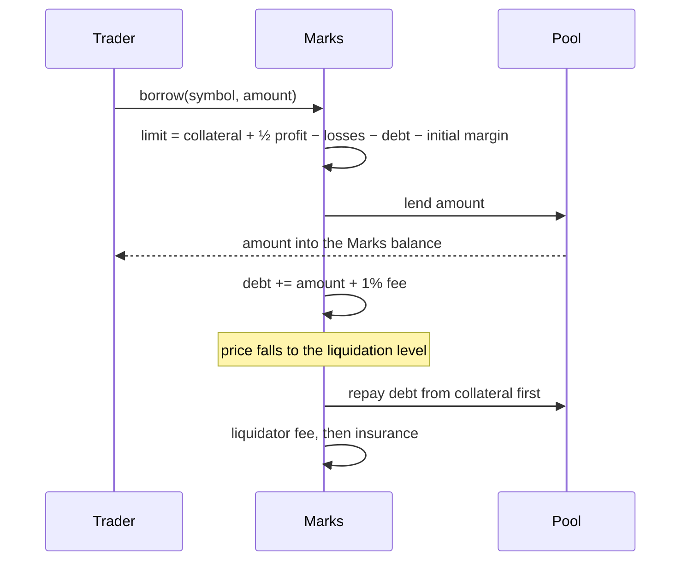
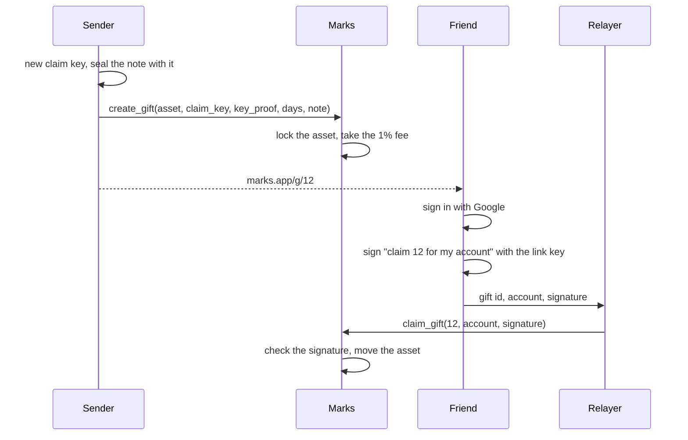
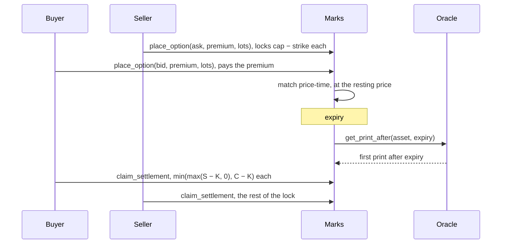
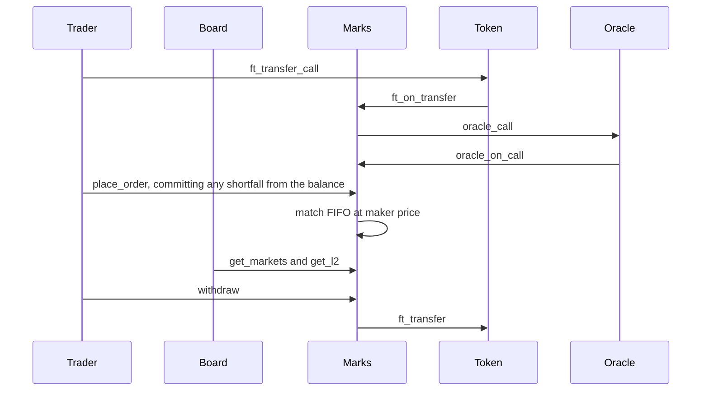

# Marks

**Trade perps and stocks on NEAR, borrow against what you hold, and give any of it away as a link.**

Marks is one NEAR contract that holds a USDC balance per account and runs four things on it: twelve perpetual order books, a desk that sells tokenized shares at the oracle price, capped call options with a fully paid worst case, and a lending pool that lends against perp positions and shares for a 1 percent fee. Any share, any USDC amount, or a whole open perp position can be sent to a friend as a link. The friend signs in with Google and owns it. They need no wallet, no seed phrase and no gas.

Everything below runs on NEAR testnet with a mock USDC that anyone can claim from a faucet.



## Borrow against a position

The pool lends USDC against an open perp. The loan is added to the position's debt. Equity in every margin check is collateral plus open profit minus debt, so the position liquidates earlier when it carries a loan. Liquidation repays the pool before anything else.



Shares borrow the same way with `borrow_against`. The shares are locked, the loan can reach 50 percent of their value, and anyone can sell them to the desk once the debt passes 65 percent.

## Send a gift

The sender's browser makes a one-time ed25519 key. The public half and a proof go on chain with the asset. The secret half goes only into the link, after the `#`, which a browser never sends to a server.



The relayer pays gas and can change nothing: the signature covers the gift id and the recipient account. A copied signature pays nobody else. The sender takes the gift back after it expires.

## Buy a capped call



Both sides are fully paid at the trade. There is no margin, no funding and no liquidation on a call.

## The math

USDC has 6 decimals inside the contract: `1000000` atoms are $1. One share unit is `1000000` units. Every fee is 1 percent, rounded up.

### Perp margin with debt

```
equity          = collateral + q × (mark − entry) − debt
initial margin  = |q| × mark × 10%
maintenance     = |q| × mark × 5%
borrow limit    = collateral + ½ × max(profit, 0) + min(profit, 0) − debt − initial margin
largest loan    = borrow limit / 1.01
liquidation     = (q × entry − (collateral − debt)) / (q × (1 − 5%))     for a long
```

Worked example on `SOL-PERP`, where one contract is 0.5 SOL and the mark is $47.87:

| Step                        | Value                                     |
| --------------------------- | ----------------------------------------- |
| Long 10 contracts at $47.87 | notional $478.70                          |
| Collateral                  | $100.00                                   |
| Initial margin              | $47.87                                    |
| Liquidation with no loan    | (478.70 − 100) / 9.5 = **$39.86**         |
| Borrow limit                | 100 − 47.87 = $52.13, largest loan $51.61 |
| Borrow $40, fee $0.40       | debt $40.40                               |
| Liquidation with the loan   | (478.70 − 59.60) / 9.5 = **$44.12**       |

The borrow page shows both liquidation prices before you confirm.

### Share loans

```
loan limit        = 50% × units × price
liquidatable when = debt > 65% × units × price
liquidation price = debt / (65% × units)
```

Lock 1 Nvidia share at $204.63 and borrow $50. The debt is $50.50 and the loan is liquidatable below $77.69. The caller of `liquidate_loan` sells the shares to the desk at the mark, the pool is repaid, the caller earns 1 percent of the sale, and the rest returns to the borrower.

### Capped calls

```
payout per contract = min(max(S − K, 0), C − K)
break-even          = K + premium
most the buyer loses  = premium
most the buyer makes  = C − K − premium
the seller locks      = C − K, and keeps the premium
```

An Apple call from $344 to $379 bought at $14: break-even $358, worst case $14, best case $21. Apple settling at $365 pays $21 back for a net $7.

### Fees

| Action                 | Fee                               | Paid to         |
| ---------------------- | --------------------------------- | --------------- |
| Borrow on a perp       | 1% of the loan, added to the debt | the fee account |
| Borrow on shares       | 1% of the loan, added to the debt | the fee account |
| Gift USDC or shares    | 1% of the value at the mark       | the fee account |
| Gift a perp position   | 1% of the position's equity       | the fee account |
| Perp liquidation       | 1% of closed notional             | the caller      |
| Share loan liquidation | 1% of the sale                    | the caller      |

### The mark

A print more than 25 percent away from the mark is held as pending. The mark moves once a second print lands within 1 percent of the pending one. One bad print changes nothing, and a real gap is followed after two.

## Gift security

The gift model is [Moi](https://github.com/ramakrishnanhulk20/Moi)'s, moved from EVM to NEAR.

| Moi (EVM)                                                   | Marks (NEAR)                                                                                   |
| ----------------------------------------------------------- | ---------------------------------------------------------------------------------------------- |
| One-time secp256k1 claim key, its address stored            | One-time ed25519 claim key, its public key stored                                              |
| `keyProof` signs `RegisterGift(sender)`                     | `key_proof` signs `marks-gift-register:{contract}:{sender}`                                    |
| `claimKeyUsed` blocks key reuse                             | `used_keys` blocks key reuse                                                                   |
| Claim signed over `(giftId, recipient)`, checked with ECDSA | Claim signs `marks-gift-claim:{contract}:{id}:{recipient}`, checked with `env::ed25519_verify` |
| Only Moi's relayer may submit a claim                       | Anyone may submit. The recipient is inside the signature                                       |
| Sender refunds after expiry                                 | Sender refunds after expiry, 1 to 90 days                                                      |
| Note sealed with AES-GCM from the key                       | Note sealed with AES-GCM from an HKDF of the key, at most 512 bytes                            |
| Gift of an ERC-20 stock token                               | Gift of USDC, of shares, or of a whole open perp position                                      |

A position gift freezes that market for the sender until it is claimed or refunded. Resting orders are cancelled. `place_order`, `release`, `borrow` and a second gift are refused. Funding and liquidation still run, and a liquidated gift becomes void. On claim the whole account on that market, with position, entry, collateral, debt and funding snapshot, moves to the recipient, who must be flat on that market.

## Contracts

| Crate       | Account                                                                                  | What it is                                                                                                                                                      |
| ----------- | ---------------------------------------------------------------------------------------- | --------------------------------------------------------------------------------------------------------------------------------------------------------------- |
| `contract/` | [`marks2-6e889d.testnet`](https://testnet.nearblocks.io/address/marks2-6e889d.testnet)   | Marks v2: balances, perps, shares, calls, the lending pool and gifts. Also the fee account.                                                                     |
| `token/`    | [`musdc-6e889d.testnet`](https://testnet.nearblocks.io/address/musdc-6e889d.testnet)     | Marks mock USDC, `mUSDC`, 6 decimals. `faucet` mints 1,000 to any account once a day. The token account is also the treasury that funded the pool and the desk. |
| `oracle/`   | [`oracle2-6e889d.testnet`](https://testnet.nearblocks.io/address/oracle2-6e889d.testnet) | Demo price feed with public prices, a short history, and `get_print_after` for call settlement.                                                                 |

`t1-6e889d` to `t6-6e889d` are the six seed traders. The pool started with 100,000 mUSDC and the share desk with 100,000 mUSDC.

The contract has no admin and no pause. A perp, a share, a call series and the fee are fixed when they are created. The release build keeps overflow checks on.

### Public methods added in v2

| Method                                                                                                                                                                       | Effect                                                                     |
| ---------------------------------------------------------------------------------------------------------------------------------------------------------------------------- | -------------------------------------------------------------------------- |
| `ft_on_transfer` with msg `""`, `"pool"` or `"desk"`                                                                                                                         | Credits the Marks balance, the lending pool, or the share desk             |
| `borrow`, `repay`                                                                                                                                                            | Perp loans against one market                                              |
| `borrow_against`, `repay_share_loan`, `liquidate_loan`                                                                                                                       | Share loans                                                                |
| `withdraw_supply`                                                                                                                                                            | A pool supplier takes back idle USDC it supplied                           |
| `list_share`, `refresh_share`, `buy_shares`, `sell_shares`                                                                                                                   | The share desk. A buy needs a price from the last hour. A sell always runs |
| `list_series`, `place_option`, `cancel_option`, `settle_series`, `claim_settlement`                                                                                          | Capped calls                                                               |
| `create_gift`, `claim_gift`, `refund_gift`                                                                                                                                   | Gifts                                                                      |
| `get_pool`, `get_shares`, `get_holdings`, `get_share_loans`, `get_series_list`, `get_option_book`, `get_option_position`, `get_gift`, `get_gifts_sent`, `get_gifts_received` | Views                                                                      |

`get_trader` also returns `debt`, `borrow_limit` and `gift_id`. Events use NEP-297 with standard `marks`, version `2.0.0`.

### Transactions

Deploy, funding, and one live pass of every flow. The seed is a few hundred more fills on the [marks2 account](https://testnet.nearblocks.io/address/marks2-6e889d.testnet).

| Step                        | Transaction                                                                                      |
| --------------------------- | ------------------------------------------------------------------------------------------------ |
| Deploy mUSDC and `new`      | [FS9vY5DEwGNt…](https://testnet.nearblocks.io/txns/FS9vY5DEwGNtQUwpfSqSjd344YFZcKVvyc96zyRWtyut) |
| Deploy the oracle and `new` | [DWwAtQF7dc1Z…](https://testnet.nearblocks.io/txns/DWwAtQF7dc1ZnvJU5wiMWhYCEWCCbZpMv9DhqEyC3tkm) |
| Deploy Marks and `new`      | [AjoxcLWyDcS3…](https://testnet.nearblocks.io/txns/AjoxcLWyDcS3W85ZYvi3HDehNjbXfFFfb5Tk95XaZb1F) |
| First perp, NEAR-PERP       | [42V7WeiDW72V…](https://testnet.nearblocks.io/txns/42V7WeiDW72VsE8Szp9xRHE2ed1DHEriKQutg18wSn9A) |
| First share                 | [2GAQxHkGJa64…](https://testnet.nearblocks.io/txns/2GAQxHkGJa64zZfecQpguoLKFY78YME6NKEUDCxRxhZv) |
| First call series           | [GnJaaR6obnP1…](https://testnet.nearblocks.io/txns/GnJaaR6obnP1Vc5gVp9Jmr4CrNeTw6oFWNqoYsLz59u2) |
| Mint the treasury           | [G2Rch6ngWwYW…](https://testnet.nearblocks.io/txns/G2Rch6ngWwYWTpEUS55Pk8bctoK7KxPCVPn6KNBh37CZ) |
| Fund the pool, 100,000      | [58YVi62vdGwz…](https://testnet.nearblocks.io/txns/58YVi62vdGwzqwTK67ijk9uyda6YjJnbLA3VaqQAp3Qv) |
| Fund the desk, 100,000      | [7b8Xt8cX7zxY…](https://testnet.nearblocks.io/txns/7b8Xt8cX7zxYqwqSXGzqZX12vdZqarM66jze9svZgv52) |
| Faucet, 1,000 to t6         | [5NujBEyqZg42…](https://testnet.nearblocks.io/txns/5NujBEyqZg42QBYWYAjQTVdkkkkjyXtvnwVBBBJNeyJm) |
| Deposit into Marks          | [En9FupWh6AHi…](https://testnet.nearblocks.io/txns/En9FupWh6AHi1Lgb5WpGdcUuQSSiNupzQGZehgUCCTYM) |
| Buy Apple shares            | [9sYF9s8rFJzS…](https://testnet.nearblocks.io/txns/9sYF9s8rFJzSXdzEHMXVUpp7KJxRgMxg8482PbvF9chS) |
| Sell a tenth of a share     | [72q26QVGEkQk…](https://testnet.nearblocks.io/txns/72q26QVGEkQk9akWzZHCb6unZ6wEjh3zw2k6onnYTuV9) |
| Borrow against shares       | [FrqzpdJRWRHj…](https://testnet.nearblocks.io/txns/FrqzpdJRWRHjAZMTEds7crYfQSrvZN4TxH4hJ1eT5D36) |
| Repay part of that loan     | [BNwnN7ojiVMa…](https://testnet.nearblocks.io/txns/BNwnN7ojiVMa9MmNauWc3qacyUU75AKnPEzXwfFncMYH) |
| Borrow on SOL-PERP          | [BVVuA2uXcdTz…](https://testnet.nearblocks.io/txns/BVVuA2uXcdTzgA6mnD8ktpG1cwn6Sn98rFW2KGi31aLm) |
| Repay part of that loan     | [5KQZKQcabBdL…](https://testnet.nearblocks.io/txns/5KQZKQcabBdLMWBPstgePW449nuzxaRF6qQSK6jCZeHG) |
| Gift 25 mUSDC               | [8Pj3TBHnvShw…](https://testnet.nearblocks.io/txns/8Pj3TBHnvShwz7ruymjw8FFNWHN1VvM2EFGiZWAvsfWn) |
| Claim that gift             | [8U4ADvz7fU1Z…](https://testnet.nearblocks.io/txns/8U4ADvz7fU1Z5nSx46ePhdUg3ARYdMz9tCUWBNGiWgEP) |
| Gift a NEAR-PERP position   | [2KEvoh4v9dyz…](https://testnet.nearblocks.io/txns/2KEvoh4v9dyziwewEDYVcnw6yvBUQemm6aGAUoWvqn8m) |
| Claim that position         | [BZncTPTHP54T…](https://testnet.nearblocks.io/txns/BZncTPTHP54T3JbMtrz4DvwJq4cTvoPmi8h83NCbWUFT) |
| Buy one capped call         | [3dom23shNqkU…](https://testnet.nearblocks.io/txns/3dom23shNqkU9rsHP9C4yRT2qsnyGrbs3AyvjYyPGkCT) |

## Run it

```sh
cargo test --manifest-path contract/Cargo.toml   # 73 tests
cargo test --manifest-path token/Cargo.toml
cargo test --manifest-path oracle/Cargo.toml
npm run format:check
cd web && npx tsc --noEmit && npx eslint .
```

Stand up v2 on new accounts, or resume a stage:

```sh
./scripts/v2.sh
./scripts/v2.sh --from-deploy | --from-feed | --from-list | --from-seed | --from-exercise
```

The v2 scripts sign through near-cli's `testnet-fastnear` connection. Set `NEAR_CLI_NETWORK` to use another one.

| Script                   | What it does                                                                                                                                                                  |
| ------------------------ | ----------------------------------------------------------------------------------------------------------------------------------------------------------------------------- |
| `scripts/v2-accounts.sh` | Creates the token, oracle, contract and six trader accounts. Appends `V2_*` lines to `testnet.env`                                                                            |
| `scripts/v2-deploy.sh`   | Builds the three crates and calls `new` on any account that has no code yet                                                                                                   |
| `scripts/v2-feed.sh`     | Fetches public prices and stores them on the oracle                                                                                                                           |
| `scripts/v2-keep.sh`     | Restamp every market before the one-hour window. The web server starts `--loop` on boot. Each market costs 0.02 NEAR                                                          |
| `scripts/v2-list.sh`     | Lists 12 perps, 7 shares and 14 call series, then funds the pool and the desk from the treasury                                                                               |
| `scripts/v2-seed.sh`     | 10 to 30 random fills per perp, 5 to 8 resting levels per side, and a quoted book on every series. Three workers sign with disjoint traders. `--options` seeds only the calls |
| `scripts/v2-exercise.sh` | Runs each flow once live: faucet, shares, both loans, a USDC gift, a position gift, a call                                                                                    |
| `scripts/v2-web-env.sh`  | Points `web/.env.local` at the v2 accounts                                                                                                                                    |
| `scripts/relay.sh`       | What the web relayer runs: `gift-claim` and `faucet`, signed by `AGENT_ID`                                                                                                    |
| `scripts/gift_keys.mjs`  | Makes a claim key and signs a claim from the shell                                                                                                                            |
| `scripts/web-check.mjs`  | Loads every page at 375, 768, 1024 and 1440 wide, reports sideways overflow and console errors                                                                                |

Keys stay in the macOS login keychain through near-cli. Account ids live in `scripts/testnet.env`.

## The web app

```sh
./scripts/v2-web-env.sh
cd web && npm install && npm run dev
```

| Path                | What it does                                                                                                                                                                                                             |
| ------------------- | ------------------------------------------------------------------------------------------------------------------------------------------------------------------------------------------------------------------------ |
| `/`                 | Hero with the 3D envelope and a certificate that cycles through a 10x BTC long, a $500 loan and a $25 Nvidia gift, live ticker, how it works, the board                                                                  |
| `/markets`          | Every perp: price, funding, open interest, volume                                                                                                                                                                        |
| `/markets/[symbol]` | Live candles at 1m, 15m, 1h and 1D, a live book, a ticket with the liquidation price, and "Borrow against this position". NEAR, SOL, ETH and BTC tick on every Coinbase trade. The other markets refresh every 4 seconds |
| `/stocks`           | Buy and sell shares, and a call picker with expiry, premium, break-even, worst case and best case                                                                                                                        |
| `/borrow`           | Perp and share loans, with the debt and the liquidation price before and after                                                                                                                                           |
| `/send`             | Send a share, USDC or a position, with a live certificate preview, the fee, the link, and every gift you sent                                                                                                            |
| `/g/[id]`           | The claim page: envelope, certificate, Google sign-in, the sealed note                                                                                                                                                   |
| `/portfolio`        | Balances, positions, shares, loans, calls and gifts in one place                                                                                                                                                         |
| `/faucet`           | Claim 1,000 mUSDC and move it into Marks. NEAR Intents is how a deposit or a withdrawal crosses chains                                                                                                                   |

Sign-in offers Google through [NEAR Auth](https://docs.auth.near.org/), a passkey, and the NEAR Connect wallets (NEAR, EVM, Solana, Stellar, TON, Tron). A Google account gets 0.05 NEAR for gas on first sign-in. The faucet and gift claims go through `/api/faucet` and `/api/gift/claim`, which run `scripts/relay.sh`, so a Google user claims both without gas. A wallet user signs the transaction in the wallet. Nightly would then broadcast it through its own node list, which rejects `send_tx` and retries until the transaction expires, so Marks broadcasts the signed transaction on FastNEAR instead. The sender's gift links are kept in that browser's local storage so they can be copied again.

The web app reads testnet through FastNEAR's RPC. Set `NEXT_PUBLIC_TESTNET_RPC` to use another.

## Limits

- **Shares are Marks ledger entries on testnet.** A share is a balance inside the contract, bought and sold at the oracle price against a desk funded with mUSDC. No share of Apple or Nvidia stands behind it.
- **Intents runs on mainnet only.** It is how a deposit arrives from another chain and how a withdrawal leaves. `scripts/intents-quote.sh` asks 1Click for a dry quote and does not send funds.
- **Prices gap over weekends.** Stock and metal prints stop when their markets close. A share buy and a perp order that adds risk wait for a print from the last hour. The two-print rule follows a Monday gap after two agreeing prints, and liquidations then run at the new mark.
- **A call settles on the first print after expiry.** A series that expires over a weekend settles on Monday's first print.
- **A position gift can be liquidated before it is claimed.** The gift becomes void and the fee stays spent.
- **The relayer can delay a claim and nothing more.** Anyone can submit a signed claim, including the recipient's own account.

## Credits

The look, the motion, the 3D envelope and certificate, the send and claim pages, and the claim-key gift model come from [Moi](https://github.com/ramakrishnanhulk20/Moi) by Ram ([ramakrishnanhulk20](https://github.com/ramakrishnanhulk20)), used under the MIT License. See [`web/NOTICE`](web/NOTICE). The files under `web/components/marks/` name their source in a header.

The desk chart is [Lightweight Charts](https://github.com/tradingview/lightweight-charts) by TradingView, used under the Apache License 2.0. The chart shows its attribution link.

## Marks v1 history

The first build is the perp market on [`marks-05a557.testnet`](https://testnet.nearblocks.io/address/marks-05a557.testnet), and the twelve-market demo is on [`marks-ffaba5.testnet`](https://testnet.nearblocks.io/address/marks-ffaba5.testnet) with [`oracle-ffaba5.testnet`](https://testnet.nearblocks.io/address/oracle-ffaba5.testnet). Both stay as they were deployed. v2 adds fields to stored structs, which changes the Borsh layout, so v2 lives on new accounts.

### How a trade moves

Collateral comes in through the token. The oracle writes the mark. The contract matches the order in the same call. A withdrawal sends the token back out.



### How a listing works

A listing is a market record, not a pile of the underlying asset. The contract does not hold Apple shares, gold, or NEAR tokens for the trade itself. Traders post quote collateral and settle the difference between their entry and the mark.

Each market stores:

- a symbol, such as `NEAR-PERP` or `AAPL-PERP`
- a category, such as `crypto`, `stock`, or `metal`
- a tick size, in quote atoms per base lot per tick
- an initial margin ratio and a maintenance margin ratio
- a funding cap
- the current mark and index, both in ticks
- an insurance balance, posted by the account that listed the market

The category only groups rows on the board. The price source is what makes a row tradable. `new` stores the collateral token and the oracle account. It does not create a market. `create_market` locks an insurance amount from the lister's unallocated balance and stores the symbol, category, tick size, margins, funding cap, funding interval, oracle asset id, and staleness window. Those fields never change. Calling `create_market` again for the same symbol fails with `market already listed`. There is no pause method and no method that edits a listing.

A crypto mark comes from `refresh_mark`, which calls `oracle_call` on the stored oracle with 0.02 NEAR attached. The oracle calls `oracle_on_call`. The predecessor must be that oracle account. Anyone else fails with `oracle only`. The payload price is `multiplier / 10^decimals` dollars. Marks turns that into ticks with the market's tick size. The first positive price is stored. After that, a print more than 25 percent from the previous mark or index is rejected with `mark moved more than 25 percent` and the old mark stays. The callback timestamp is stored.

A metal or a stock stores a `custom_call` request instead of a built-in asset id. `refresh_mark` sends that request. The oracle calls `on_custom_data`. A missing value or an error string fails with `price missing` and does not write a price. The contract never invents one.

When the mark is still zero, or older than the staleness window stored at creation, an order that increases worst-case size fails with `mark is stale`. Cancels, reductions, releases, and liquidations still run. Collateral committed to one symbol cannot pay a loss on another. Unallocated balance is the only balance `withdraw` can send.

### The numbers

All amounts inside the contract are integers.

- A **quote atom** is the collateral unit. With a 6 decimal USDC, `1000000` atoms are 1 USDC.
- A **tick** is the integer price on the book.
- A **lot** is the integer size of an order or a position.
- Quote atoms per base lot = `ticks × tick size`.
- Long size is positive. Short size is negative.

The deployed market uses a tick size of `1000000`. A mark of 5 ticks means 5 USDC per base lot. An order of 10 lots at that mark has a notional of 50 USDC.

#### Profit

Unrealized profit is:

```
q × (mark − entry)
```

`q` is the signed size in lots. `mark` and `entry` are quote atoms per lot. Equity is collateral plus that profit.

Buy 10 lots at 5 when the account is flat. The position is long 10 with entry 5. At a mark of 6 the unrealized profit is 10. A short of 10 from the same entry, at the same mark, has unrealized profit of −10.

Adding size keeps a weighted entry. 10 lots at 4, then 10 lots at 6, leaves 20 lots with entry 5.

Reducing size realizes profit into collateral and leaves the open size at the old entry. A long of 20 at entry 55, selling 10 at 70, realizes 150 and still has 10 lots at entry 55.

Selling through zero closes the long, realizes that profit, and opens a short whose entry is the fill price.

#### Margin

Notional is the absolute size times the mark, in quote atoms. Initial margin is notional times the initial ratio. Maintenance margin is notional times the maintenance ratio. The deployed market uses 10 percent initial and 5 percent maintenance, so the basis point values are `1000` and `500`.

A resting order reserves initial margin as if every order on the heavier side had filled. The heavier side is the larger absolute position after either all bids fill or all asks fill. Equity has to stay above that initial margin to rest a new order. Free collateral is the amount that can leave while equity stays above initial margin, and it cannot exceed the collateral balance.

#### Liquidation

Anyone can call `liquidate` when equity falls through maintenance margin. The mark where that happens, for a long, is:

```
(C − q × entry) × 10000 / (q × (maintenance_bps − 10000))
```

For a short, the denominator is `−q × (maintenance_bps + 10000)`.

Worked example. Long 10, entry 5,000,000 quote atoms per lot, collateral 10,000,000, maintenance 5 percent. The liquidation mark is 4,210,526 quote atoms per lot, about 4.21 if the entry was 5 USDC. The short of the same size liquidates at 5,714,285 quote atoms per lot, about 5.71.

`liquidate` may be called by anyone. It settles funding first. A flat account, or one whose equity is still at or above maintenance, fails with `not liquidatable` and no order is cancelled. An under-margined account has its resting orders on that symbol cancelled, then the whole position closes at the mark. The caller receives 1 percent of the closed notional, taken from the collateral that remains after the close. If the realized loss is larger than the collateral, the account is left at zero and the deficit is paid from that market's insurance. Whatever insurance cannot cover is added to `bad_debt`.

The order ticket shows that price before the trade, assuming this order is the whole position and only the 10 percent initial margin is posted. A long at that margin liquidates a little over 5 percent below the entry. A short liquidates a little over 5 percent above it. Extra collateral moves the price further away. After the fill, the Position tab shows the price the contract computed from the collateral actually committed to that market. A flat position has none.

#### Funding

The contract charges funding when a trader acts, and when anyone calls `settle_funding`.

```
rate = clamp((mark − index) / index, −cap, +cap)
payment = q × index × rate
```

A positive rate means longs pay shorts. A negative rate means shorts pay longs. The payments sum to zero because every long lot has a short lot on the other side. The market stores one cumulative index, in quote atoms per lot. A trader pays `size × (index − index last time they settled)`. A flat trader pays nothing. One call applies at most 24 elapsed intervals. Time left over waits for the next call. The interval is chosen when the market is created and does not change. The testnet listing uses 10 seconds so a script can see the charge. A listing meant to run for real uses one hour. On the deployed market the cap is 50 basis points. When the mark and the index are equal, the rate is 0. The testnet market is in that state: both are 4 ticks, and `settle_funding` returned `"0"`. With the mark at 6 and the index at 5, the raw premium is 20 percent and the cap cuts it to 50 basis points, so a long of 10 lots pays 250,000 quote atoms per interval.

#### The book

An incoming buy walks asks from the lowest price upward. An incoming sell walks bids from the highest price downward. At one price, the older order is first. The quote on a fill is `lots × ticks × tick size`.

Three order kinds:

| Kind                  | What it does                                                                                                                |
| --------------------- | --------------------------------------------------------------------------------------------------------------------------- |
| `limit`               | Fills against resting orders at their prices, then rests what is left.                                                      |
| `post_only`           | Rests when it does not cross. A crossing post-only order is rejected with `post-only order would cross` and writes nothing. |
| `immediate_or_cancel` | Fills what it can and rests nothing. A miss returns no order id and `filled_lots` of 0.                                     |

A fill is applied to both accounts before anything is written. The fill price is the resting order's price. Realized profit is added to that trader's collateral. Open interest is the sum of long lots. Volume is the quote atoms of every fill.

If the next resting order belongs to the incoming trader, the call fails with `self-trade` and the book is unchanged. If the incoming order would take more than 16 resting orders, the call fails with `book too dense` and the book is unchanged. A limit order that takes fewer than 16 and still has size left rests that remainder.

Margin is checked twice before the write. The incoming order is projected as a fill at its own price, so a bid far above the mark has to lock that loss. The size that will actually rest is also checked at the mark, which is the initial margin shown on the trader. A maker who is already resting is filled at the price they posted.

### What is built

The source and the wasm on `marks-05a557.testnet` settle funding, liquidate, commit collateral per market, withdraw through the token, match orders, and accept a mark only from the oracle account. `marks-k7q2p8.testnet` is the earlier build. It still rejects a cross, and it has no `settle_funding`, `liquidate`, `commit`, `withdraw`, `create_market`, or `oracle_on_call`. That account is left as it is. Do not put real funds on either deployment.

### Repository

```
contract/          NEAR contract
  src/lib.rs       public methods
  src/oracle.rs    dollar prices to ticks, and the oracle payload shapes
  src/views.rs     JSON shapes returned to clients
  src/api_tests.rs calls every public method through the local NEAR runtime
  src/math/        integer formulas
  src/exchange/    the market, the ledger, and the book
oracle/            demo price feed. It stores public prices and a short history.
token/             NEP-141 collateral used on testnet
web/               Next.js board. The header switch selects testnet or mainnet.
scripts/           testnet account, deploy, call, quote, and Intents scripts
  testnet.env      account ids and market parameters
```

### Checks

`cargo test` for `contract/`, `token/`, and `oracle/` runs every market function against named inputs. `npm run format:check` runs Prettier on the web app and the docs. `.github/workflows/ci.yml` runs Prettier, `tsc`, rustfmt, and those test suites.

#### Math

| File              | What it owns                                                        |
| ----------------- | ------------------------------------------------------------------- |
| `math/quote.rs`   | ticks and lots to quote atoms                                       |
| `math/pnl.rs`     | unrealized profit and equity                                        |
| `math/margin.rs`  | initial margin, free collateral, worst-case size, liquidation price |
| `math/funding.rs` | clamped funding rate and the signed payment                         |
| `math/fill.rs`    | how a fill changes size, entry, and realized profit                 |
| `math/tests.rs`   | one test per formula, including the worked examples above           |

#### Exchange

| File                     | What it owns                                                 |
| ------------------------ | ------------------------------------------------------------ |
| `exchange/mod.rs`        | the `Exchange` state and `new`                               |
| `exchange/types.rs`      | market, trader, order, level, and parameter checks           |
| `exchange/error.rs`      | the error strings the contract panics with                   |
| `exchange/collateral.rs` | credit and the withdrawal check                              |
| `exchange/mark.rs`       | the internal mark write and the 25 percent band              |
| `exchange/orders.rs`     | place, cancel, and the price-time book                       |
| `exchange/match.rs`      | FIFO fills, the 16-fill cap, and self-trade                  |
| `exchange/account.rs`    | trader reads and the margin check used before an order rests |
| `exchange/funding.rs`    | the funding index and per-trader settlement                  |
| `exchange/liquidate.rs`  | closing an under-margined position, the fee, and insurance   |

#### Public methods

| Method                 | Caller                    | Effect                                                                                                            |
| ---------------------- | ------------------------- | ----------------------------------------------------------------------------------------------------------------- |
| `new`                  | deploy transaction        | Stores the collateral token and the oracle account. Can run once.                                                 |
| `create_market`        | the lister                | Locks insurance and stores one market. The same symbol cannot be listed again.                                    |
| `ft_on_transfer`       | the collateral token only | Credits the sender's unallocated balance. Returns `"0"`.                                                          |
| `commit`               | the trader                | Moves unallocated balance into the named market.                                                                  |
| `release`              | the trader                | Moves free collateral from the market back to unallocated.                                                        |
| `withdraw`             | the trader                | Sends unallocated balance out through the collateral token.                                                       |
| `on_withdraw`          | the contract account      | Credits the amount back when the token transfer fails.                                                            |
| `refresh_mark`         | anyone                    | Pays the oracle 0.02 NEAR to fetch this market's price.                                                           |
| `oracle_on_call`       | the oracle account only   | Stores a built-in asset price.                                                                                    |
| `on_custom_data`       | the oracle account only   | Stores a custom fetch, or fails with `price missing`.                                                             |
| `place_order`          | the trader                | Fills against the named book, then rests a limit or post-only remainder. Returns `filled_lots` and `rested_lots`. |
| `cancel_order`         | the order's owner         | Removes the order and releases its reserved size.                                                                 |
| `get_markets`          | anyone                    | Every listing.                                                                                                    |
| `get_market`           | anyone                    | One symbol: ratios, mark, index, insurance, open interest, volume, asset id.                                      |
| `get_trader`           | anyone                    | Collateral, position, profit, margin, free collateral, liquidation price, unallocated balance.                    |
| `get_l2`               | anyone                    | Top of book, bids high to low, asks low to high.                                                                  |
| `get_order`            | anyone                    | One order, or null.                                                                                               |
| `settle_funding`       | the trader                | Advances the funding index by up to 24 intervals and charges the caller.                                          |
| `liquidate`            | anyone                    | Closes an under-margined position at the mark and pays the caller 1 percent of notional.                          |
| `get_funding_rate_bps` | anyone                    | Clamped funding rate in basis points for one symbol.                                                              |

`ft_on_transfer` is the NEP-141 hook. Only the collateral token can call it. The amount is credited to the sender's unallocated balance and the hook returns `"0"`, so the token keeps the deposit. A wallet that calls the hook itself is rejected. An amount of zero is rejected.

`commit` moves unallocated balance into the named market. Margin, profit, and funding for that market use only the committed balance. `release` moves free collateral back to unallocated. It leaves enough in the market to cover initial margin. `withdraw` sends unallocated balance to the caller through `ft_transfer`. If that transfer fails, `on_withdraw` credits the amount back.

The test token in `token/` is a NEP-141 with 6 decimals. Its symbol is `USDC` and its name is Marks USD. Only the account that deploys it can mint. Traders register with `storage_deposit`, receive a mint, and deposit with `ft_transfer_call`.

### Local tests

```sh
cargo test --manifest-path contract/Cargo.toml
cargo test --manifest-path token/Cargo.toml
cargo test --manifest-path oracle/Cargo.toml
```

The tests cover each math function, order queueing, margin, cancellation, the mark band, fills, and a full pass through the public methods on the local NEAR runtime.

The release build keeps overflow checks on, so the wasm rejects an overflowing amount the same way the tests do.

### Testnet

The live contract is [`marks-05a557.testnet`](https://testnet.nearblocks.io/address/marks-05a557.testnet).

| Account                                                                                | Role                                                                               |
| -------------------------------------------------------------------------------------- | ---------------------------------------------------------------------------------- |
| [`marks-05a557.testnet`](https://testnet.nearblocks.io/address/marks-05a557.testnet)   | The market contract. `new` stored the collateral token and `price-oracle.testnet`. |
| [`usdc-05a557.testnet`](https://testnet.nearblocks.io/address/usdc-05a557.testnet)     | The NEP-141 collateral. Only this account can mint.                                |
| [`trader-05a557.testnet`](https://testnet.nearblocks.io/address/trader-05a557.testnet) | Listed the market and is flat after the flatten.                                   |
| [`taker-05a557.testnet`](https://testnet.nearblocks.io/address/taker-05a557.testnet)   | Long 1 lot.                                                                        |
| [`agent-05a557.testnet`](https://testnet.nearblocks.io/address/agent-05a557.testnet)   | Short 1 lot, with a post-only bid still resting.                                   |
| [`price-oracle.testnet`](https://testnet.nearblocks.io/address/price-oracle.testnet)   | The only account that can write a mark.                                            |

The earlier contract [`marks-k7q2p8.testnet`](https://testnet.nearblocks.io/address/marks-k7q2p8.testnet) and its signer [`usdc-k7q2p8.testnet`](https://testnet.nearblocks.io/address/usdc-k7q2p8.testnet) are unchanged. That deploy is https://testnet.nearblocks.io/txns/BvZNjZS7t82VtdfMo6sN1i913oqL61CSBmzn82KhAjrL. It has no matching, funding settlement, liquidation, or oracle callback.

`create_market` stored `NEAR-PERP`, category `crypto`, tick size `1000000`, initial margin 10 percent, maintenance margin 5 percent, funding cap 50 basis points, funding interval 10 seconds, and staleness window 120 seconds. The oracle asset id is `wrap.near`. Insurance locked at listing is `1000000` quote atoms. The mark and the index are both 4 ticks. Open interest is 1 lot. Volume is `13000000` quote atoms, from the cross, the flatten, and the agent fill. The book has one bid, 1 lot at tick 3, and no asks. Funding rate is 0. Bad debt is 0.

| Call                                | Transaction                                                                     |
| ----------------------------------- | ------------------------------------------------------------------------------- |
| deploy and `new`                    | https://testnet.nearblocks.io/txns/3dgN22rkzaEouiXNBnUxwGUexZpthGp7fj84M9xSSkUD |
| insurance deposit, `1000000`        | https://testnet.nearblocks.io/txns/J7gDbPqJWCEoUJ16pCyYsrbpZXg7bVFMUcB5A2ZBdTSP |
| `create_market`                     | https://testnet.nearblocks.io/txns/hv4QA12b4499W2KsmFfVXcXwo1EDDYMW2QZyrz55bjK  |
| first mark, 4 ticks                 | https://testnet.nearblocks.io/txns/4wqyJtBh6xj97kyUXPnqcxUqQ8R747PGCcHcEF2nMMs9 |
| `refresh_mark`                      | https://testnet.nearblocks.io/txns/9YvHwcTSSWySWHP7WEeAgX5h2Z9T68xCx58164nP8jTF |
| trader `commit` of `50000000`       | https://testnet.nearblocks.io/txns/6WuQGJE1ZcptuvfCHMzbcft4A32NXhLk1jSYmtL28fac |
| taker `commit` of `50000000`        | https://testnet.nearblocks.io/txns/2YtcjnfWK9DZaVDmVNoihPsMpsbuLQSWoVHDScbKNpx7 |
| resting bid, order 1, tick 3        | https://testnet.nearblocks.io/txns/Gu89NwWBeZP7tbaAfHEAmiYQGtDXPEexQsXxYfpuvGFk |
| taker fill, 1 lot at tick 4         | https://testnet.nearblocks.io/txns/67nfT3f6PdL3MAbxW9xzNLHYw1KM2UENxy8oWqWFrxmD |
| cancel order 1                      | https://testnet.nearblocks.io/txns/3Dzsxr1Jib8SC68E3FSLiy8PenkWd4auwPWawGVC8QWc |
| `settle_funding`, payment `0`       | https://testnet.nearblocks.io/txns/EZgtc9z3vuagTrvCRM97ZoUMwpq3e6Tq37iyri4U6YDP |
| `withdraw` of `9000000`             | https://testnet.nearblocks.io/txns/Ap6QsgRrZMWMfH1Z4H1eKNGtJfHdHM7vQpyPrWEQCfrF |
| flatten                             | https://testnet.nearblocks.io/txns/8FfbVVJ13rQpHDPy1kfreWxkzkR24KtG3nLKSnZ9CdTN |
| agent `commit` of `10000000`        | https://testnet.nearblocks.io/txns/9HQXbv6wZZxvC7GG9oDjrHnmDWZGdGYzjeL8ehFAGpBk |
| taker lifts the agent ask at tick 5 | https://testnet.nearblocks.io/txns/CFxLQ9oNCKz6cPtskdCrcsbSG13kSt7fmvQA2uczQutf |

`liquidate` against the healthy taker was rejected. A gold custom fetch returned a DNS error and no price, so no `XAU-PERP` row was created: https://testnet.nearblocks.io/txns/BQ1cfkKWHTVTwiDwPibS5QFwknR5UwaBTafWo4zTqWpX.

Account ids and market parameters live in `scripts/testnet.env`. Keys stay in the near-cli keychain.

#### Scripts

The scripts use `near` when it is on the path, otherwise the local `near-cli-rs` binary.

Create one account:

```sh
./scripts/create-account.sh my-name.testnet
```

Create the next contract account and the next collateral account, and point `scripts/testnet.env` at them:

```sh
./scripts/create-accounts.sh
```

Build the wasm, deploy it, and call `new` with the parameters in `scripts/testnet.env`:

```sh
./scripts/deploy.sh
```

`new` can succeed only once on an account. A later code deploy, which keeps the existing state, is:

```sh
./scripts/deploy.sh --upgrade
```

Read the market that `scripts/testnet.env` points at:

```sh
./scripts/exercise.sh
```

Create accounts, deploy, and call every public method in order. With no flag this replaces the accounts in `scripts/testnet.env`:

```sh
./scripts/e2e.sh
```

Rerun one method when something fails. A JSON object or a path to a JSON file both work:

```sh
./scripts/call.sh view get_market '{"symbol":"NEAR-PERP"}'
./scripts/call.sh view get_l2 '{"symbol":"NEAR-PERP","depth":5}'
./scripts/call.sh call refresh_mark '{"symbol":"NEAR-PERP"}'
```

The signer on `call` defaults to `CONTRACT_ID`. `refresh_mark` attaches 0.02 NEAR from that account. Pass another account when the predecessor has to be a trader.

Nearblocks is the explorer for these transactions. An account is `https://testnet.nearblocks.io/address/<account>`. A transaction is `https://testnet.nearblocks.io/txns/<hash>`.

### Demo markets

The original `NEAR-PERP` market stays on [`marks-05a557.testnet`](https://testnet.nearblocks.io/address/marks-05a557.testnet). That contract can only take a mark from `price-oracle.testnet`, and that account is fixed inside `new`. The demo board is a second deploy.

| Account                                                                                | Role                                                                                      |
| -------------------------------------------------------------------------------------- | ----------------------------------------------------------------------------------------- |
| [`marks-ffaba5.testnet`](https://testnet.nearblocks.io/address/marks-ffaba5.testnet)   | Twelve markets. Collateral is still `usdc-05a557.testnet`. The oracle is `oracle-ffaba5`. |
| [`oracle-ffaba5.testnet`](https://testnet.nearblocks.io/address/oracle-ffaba5.testnet) | Stores the latest dollar price of one contract and up to 48 recent prints.                |

`./scripts/demo.sh` creates those two accounts, appends `DEMO_CONTRACT_ID` and `DEMO_ORACLE_ID` to `scripts/testnet.env`, and does not run `create-accounts.sh`. Keys stay in the near-cli keychain. `scripts/demo_feed.py` reads CoinGecko for NEAR, SOL, ETH, BTC, and BNB, and Yahoo Finance for gold, oil, and the five shares. A failed fetch stops the script. It does not fill in a number. The stored price is the price of one contract. Marks still keeps only the latest mark. The chart draws the public session as green and red candles, with the volume underneath. Switches above the chart change the candle to 1 minute, 15 minutes, 1 hour, or 1 day. A missed 15 minute fetch falls back to the oracle prints.

`refresh_mark` still attaches 0.02 NEAR. The feed's `oracle_call` is payable, so it accepts that fee and calls `oracle_on_call`. The first positive price is the mark. A later print more than 25 percent away leaves the old mark in place. Each demo market uses the same 10 percent initial margin, 5 percent maintenance margin, 50 basis point funding cap, and 10 second funding interval as `NEAR-PERP`. Insurance is 0. The staleness window is one hour (`3600000000000` nanoseconds). After that hour, a new order that adds risk waits until the feed runs again. Closes and withdrawals stay open. The tick size is `10000`, so one tick is one cent.

One contract is a slice of the asset, chosen so about 300 USDC lands on a whole number of contracts at a round reference price:

| Market      | One contract | Round price | Contracts in 300 USDC |
| ----------- | ------------ | ----------- | --------------------- |
| `NEAR-PERP` | 1 NEAR       | $4          | 75                    |
| `SOL-PERP`  | 0.5 SOL      | $150 a coin | 4                     |
| `ETH-PERP`  | 0.01 ETH     | $3,000      | 10                    |
| `BTC-PERP`  | 0.001 BTC    | $100,000    | 3                     |
| `BNB-PERP`  | 0.1 BNB      | $600        | 5                     |
| `GOLD-PERP` | 0.1 oz       | $300        | 1                     |
| `OIL-PERP`  | 1 barrel     | $75         | 4                     |
| shares      | 1 share      | the print   | as many as 300 covers |

The live feed uses the public price. The ticket takes a USDC amount, turns it into whole contracts at the limit price, and shows the exact cost. At the seeded marks, 300 USDC bought 69 NEAR contracts for $296.70, 6 SOL contracts for $288.36, 13 ETH contracts for $291.59, 3 BTC contracts for $231.63, 4 BNB contracts for $281.48, 2 oil contracts for $205.88, 1 Nvidia share for $204.63, and 1 Amazon share for $240.35. Gold was $388.48 per 0.1 oz, Apple $344.63, Tesla $399.80, and Microsoft $521.90, so 300 USDC was below one contract. The seed traded one contract on those four so the row still has open interest, and the ticket tells a buyer to raise the amount. Initial margin stays 10 percent, so a $296.70 position needs $29.67 of test USDC in that market. The ticket commits that shortfall from the Marks balance in the same transaction as the order. A balance that cannot cover it is refused before the wallet opens. The web server starts `./scripts/v2-keep.sh --loop` when it boots, so the prices stay inside the hour for as long as the server stays up. On this machine that script signs with the near-cli keychain. A deployed server does not have that keychain, so it signs with `MARKS_KEEPER_ACCOUNT` and `MARKS_KEEPER_KEY` instead. Each stamp costs 0.02 NEAR. The agent pays while it can stay above 2 NEAR, then the contract account pays. Set `MARKS_KEEPER=off` to leave the loop stopped. If the keeper is not running, the ticket refreshes that market before the order and the wallet approves the same 0.02 NEAR fee first.

`trader-05a557.testnet` sold and `taker-05a557.testnet` bought. The token account minted the collateral. Every row has a price, open interest, and traded volume.

```sh
./scripts/demo.sh
./scripts/demo.sh --from-feed
./scripts/demo.sh --from-list
./scripts/demo.sh --from-trade
```

### The board

`web/` is a Next.js app. The index reads `get_markets` and shows symbol, category, price in USDC, funding in plain words, open interest in USDC, and how much has traded. On a market page, a phone shows the price, the chart, and the order book first. The long/short card follows them. From 768 pixels up, the desk fills the window: the chart grows into the space under the market header, the book sits under the chart, and the card stays on the right. The amount field takes USDC. Typing `300` shows the whole contracts that amount buys and the exact USDC those contracts cost. The header switches the board and the wallet between testnet and mainnet. Testnet reads the demo contract. Mainnet stays empty until `NEXT_PUBLIC_MAINNET_CONTRACT_ID` is set.

Sign-in offers a passkey, Google, and the NEAR Connect list used by near.com: NEAR, EVM, Solana, Stellar, TON, and Tron. Google uses [NEAR Auth](https://docs.auth.near.org/) on testnet. The shared testnet client opens an Auth0 window, and Google is one of the choices there. That login derives an implicit testnet account from the MPC key for the Google identity. The first time, `./scripts/auth-fund.sh` sends 0.05 NEAR from `agent-05a557.testnet` so the account can pay gas, and it stops if that agent would drop below 2 NEAR. An order asks NEAR Auth to approve the exact transaction, then `./scripts/auth-sign.sh` submits that approval to `fast-auth.testnet`. The agent pays the signature call. The order itself is signed by the derived key and paid by the implicit account. A NEAR or EVM wallet signs `place_order` and `cancel_order` directly. When the market needs more margin than is already there, that same transaction commits the shortfall from the Marks balance first. The Position tab can still commit or release on its own. Mainnet has no NEAR Auth client in this app.

```sh
# web/.env.local, written by scripts/demo.sh
NEXT_PUBLIC_CONTRACT_ID=marks-ffaba5.testnet
NEXT_PUBLIC_ORACLE_ID=oracle-ffaba5.testnet
cd web && npm run dev
```

### NEAR Intents

Intents has no testnet. The contract does not grow a second deposit method. A cross-chain deposit is a 1Click swap whose destination asset is USDC on NEAR and whose recipient is the Marks account, so a real send would arrive as collateral. The default run does not send funds.

```sh
./scripts/intents-quote.sh
```

That posts to `https://1click.chaindefuser.com/v0/quote` with `dry: true`. The script requires `quote.amountOut` to be present and non-zero, and requires the body to have no deposit address. A dry run on 30 October 2026 returned `994846`. The board's deposit panel sends the same request. Unchecking the dry default asks for a live quote, which spends real USDC on mainnet. The script never does that.

The recipient in the default script is `marks.near`, because the contract in this repo is on testnet and Intents quotes mainnet. Set `INTENTS_RECIPIENT` to the mainnet Marks account when one exists.

### The quoting agent

`agent-05a557.testnet` is funded with the test token. `./scripts/quote.sh` commits `10000000` quote atoms on `NEAR-PERP`, cancels the agent's previous two orders, and places a post-only bid one tick under the mark and a post-only ask one tick over the mark, one lot each.

`./scripts/e2e.sh` flattens the earlier cross, then immediate-or-cancels that ask from `taker-05a557.testnet`. The ask leaves the book. The agent is short 1 lot. The taker is long 1 lot. The bid at tick 3 is still resting. The fill is https://testnet.nearblocks.io/txns/CFxLQ9oNCKz6cPtskdCrcsbSG13kSt7fmvQA2uczQutf.
