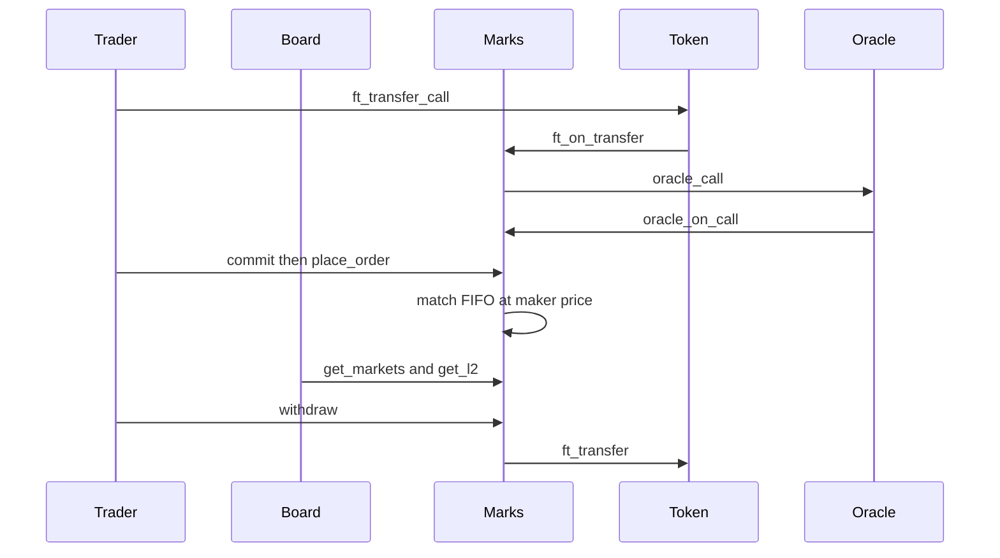

# Marks

Marks is a perpetual market on NEAR. A trader posts USDC into the contract and trades a price. A long profits when the mark rises. A short profits when it falls. The contract keeps the balances itself, matches orders in its own state, and has no admin method that can halt the book.

The front of the product is a market board in the spirit of [tokens.xyz](https://tokens.xyz): each row is a market, with a mark price, volume, and open interest. Crypto, metals, and stocks are categories on that board. Opening a row leads to an order book.

This is the Unstoppable DeFi track of the [NEAR hackathon](https://nearhackathon.com/). The track asks for exchanges, perps, and trading agents that settle across chains, with no custodian and nobody who can switch the market off. The repository is Marks on Near.

## How a trade moves

Collateral comes in through the token. The oracle writes the mark. The contract matches the order in the same call. A withdrawal sends the token back out.



## How a listing works

A listing is a market record, not a pile of the underlying asset. The contract does not hold Apple shares, gold, or NEAR tokens for the trade itself. Traders post quote collateral and settle the difference between their entry and the mark.

Each market stores:

- a symbol, such as `NEAR-PERP` or `AAPL-PERP`
- a category, such as `crypto`, `stock`, or `metal`
- a tick size, in quote atoms per base lot per tick
- an initial margin ratio and a maintenance margin ratio
- a funding cap
- the current mark and index, both in ticks
- an insurance balance, posted by the account that listed the market

The category only groups rows on the board. The price source is what makes a row tradable. `new` stores the collateral token and the oracle account. It does not create a market. `create_market` locks an insurance amount from the lister's unallocated balance and stores the symbol, category, tick size, margins, funding cap, funding interval, oracle asset id, and staleness window. Those fields never change. Calling `create_market` again for the same symbol fails with `market already listed`. There is no pause method and no method that edits a listing.

A crypto mark comes from `refresh_mark`, which calls `oracle_call` on the stored oracle with 0.02 NEAR attached. The oracle calls `oracle_on_call`. The predecessor must be that oracle account. Anyone else fails with `oracle only`. The payload price is `multiplier / 10^decimals` dollars. Marks turns that into ticks with the market's tick size. The first positive price is stored. After that, a print more than 25 percent from the previous mark or index is rejected with `mark moved more than 25 percent` and the old mark stays. The callback timestamp is stored.

A metal or a stock stores a `custom_call` request instead of a built-in asset id. `refresh_mark` sends that request. The oracle calls `on_custom_data`. A missing value or an error string fails with `price missing` and does not write a price. The contract never invents one.

When the mark is still zero, or older than the staleness window stored at creation, an order that increases worst-case size fails with `mark is stale`. Cancels, reductions, releases, and liquidations still run. Collateral committed to one symbol cannot pay a loss on another. Unallocated balance is the only balance `withdraw` can send.

## The numbers

All amounts inside the contract are integers.

- A **quote atom** is the collateral unit. With a 6 decimal USDC, `1000000` atoms are 1 USDC.
- A **tick** is the integer price on the book.
- A **lot** is the integer size of an order or a position.
- Quote atoms per base lot = `ticks × tick size`.
- Long size is positive. Short size is negative.

The deployed market uses a tick size of `1000000`. A mark of 5 ticks means 5 USDC per base lot. An order of 10 lots at that mark has a notional of 50 USDC.

### Profit

Unrealized profit is:

```
q × (mark − entry)
```

`q` is the signed size in lots. `mark` and `entry` are quote atoms per lot. Equity is collateral plus that profit.

Buy 10 lots at 5 when the account is flat. The position is long 10 with entry 5. At a mark of 6 the unrealized profit is 10. A short of 10 from the same entry, at the same mark, has unrealized profit of −10.

Adding size keeps a weighted entry. 10 lots at 4, then 10 lots at 6, leaves 20 lots with entry 5.

Reducing size realizes profit into collateral and leaves the open size at the old entry. A long of 20 at entry 55, selling 10 at 70, realizes 150 and still has 10 lots at entry 55.

Selling through zero closes the long, realizes that profit, and opens a short whose entry is the fill price.

### Margin

Notional is the absolute size times the mark, in quote atoms. Initial margin is notional times the initial ratio. Maintenance margin is notional times the maintenance ratio. The deployed market uses 10 percent initial and 5 percent maintenance, so the basis point values are `1000` and `500`.

A resting order reserves initial margin as if every order on the heavier side had filled. The heavier side is the larger absolute position after either all bids fill or all asks fill. Equity has to stay above that initial margin to rest a new order. Free collateral is the amount that can leave while equity stays above initial margin, and it cannot exceed the collateral balance.

### Liquidation

Anyone can call `liquidate` when equity falls through maintenance margin. The mark where that happens, for a long, is:

```
(C − q × entry) × 10000 / (q × (maintenance_bps − 10000))
```

For a short, the denominator is `−q × (maintenance_bps + 10000)`.

Worked example. Long 10, entry 5,000,000 quote atoms per lot, collateral 10,000,000, maintenance 5 percent. The liquidation mark is 4,210,526 quote atoms per lot, about 4.21 if the entry was 5 USDC. The short of the same size liquidates at 5,714,285 quote atoms per lot, about 5.71.

`liquidate` may be called by anyone. It settles funding first. A flat account, or one whose equity is still at or above maintenance, fails with `not liquidatable` and no order is cancelled. An under-margined account has its resting orders on that symbol cancelled, then the whole position closes at the mark. The caller receives 1 percent of the closed notional, taken from the collateral that remains after the close. If the realized loss is larger than the collateral, the account is left at zero and the deficit is paid from that market's insurance. Whatever insurance cannot cover is added to `bad_debt`.

### Funding

The contract charges funding when a trader acts, and when anyone calls `settle_funding`.

```
rate = clamp((mark − index) / index, −cap, +cap)
payment = q × index × rate
```

A positive rate means longs pay shorts. A negative rate means shorts pay longs. The payments sum to zero because every long lot has a short lot on the other side. The market stores one cumulative index, in quote atoms per lot. A trader pays `size × (index − index last time they settled)`. A flat trader pays nothing. One call applies at most 24 elapsed intervals. Time left over waits for the next call. The interval is chosen when the market is created and does not change. The testnet listing uses 10 seconds so a script can see the charge. A listing meant to run for real uses one hour. On the deployed market the cap is 50 basis points. When the mark and the index are equal, the rate is 0. The testnet market is in that state: both are 4 ticks, and `settle_funding` returned `"0"`. With the mark at 6 and the index at 5, the raw premium is 20 percent and the cap cuts it to 50 basis points, so a long of 10 lots pays 250,000 quote atoms per interval.

### The book

An incoming buy walks asks from the lowest price upward. An incoming sell walks bids from the highest price downward. At one price, the older order is first. The quote on a fill is `lots × ticks × tick size`.

Three order kinds:

| Kind                  | What it does                                                                                                                |
| --------------------- | --------------------------------------------------------------------------------------------------------------------------- |
| `limit`               | Fills against resting orders at their prices, then rests what is left.                                                      |
| `post_only`           | Rests when it does not cross. A crossing post-only order is rejected with `post-only order would cross` and writes nothing. |
| `immediate_or_cancel` | Fills what it can and rests nothing. A miss returns no order id and `filled_lots` of 0.                                     |

A fill is applied to both accounts before anything is written. The fill price is the resting order's price. Realized profit is added to that trader's collateral. Open interest is the sum of long lots. Volume is the quote atoms of every fill.

If the next resting order belongs to the incoming trader, the call fails with `self-trade` and the book is unchanged. If the incoming order would take more than 16 resting orders, the call fails with `book too dense` and the book is unchanged. A limit order that takes fewer than 16 and still has size left rests that remainder.

Margin is checked twice before the write. The incoming order is projected as a fill at its own price, so a bid far above the mark has to lock that loss. The size that will actually rest is also checked at the mark, which is the initial margin shown on the trader. A maker who is already resting is filled at the price they posted.

## What is built

The source and the wasm on `marks-05a557.testnet` settle funding, liquidate, commit collateral per market, withdraw through the token, match orders, and accept a mark only from the oracle account. `marks-k7q2p8.testnet` is the earlier build. It still rejects a cross, and it has no `settle_funding`, `liquidate`, `commit`, `withdraw`, `create_market`, or `oracle_on_call`. That account is left as it is. Do not put real funds on either deployment.

## Repository

```
contract/          NEAR contract
  src/lib.rs       public methods
  src/oracle.rs    dollar prices to ticks, and the oracle payload shapes
  src/views.rs     JSON shapes returned to clients
  src/api_tests.rs calls every public method through the local NEAR runtime
  src/math/        integer formulas
  src/exchange/    the market, the ledger, and the book
token/             NEP-141 collateral used on testnet
web/               Next.js board. The header switch selects testnet or mainnet. Testnet reads marks-05a557.testnet.
scripts/           testnet account, deploy, call, quote, and Intents scripts
  testnet.env      account ids and market parameters
```

## Checks

`cargo test` for `contract/` and `token/` runs every market function against named inputs. `npm run format:check` runs Prettier on the web app and the docs. `.github/workflows/ci.yml` runs Prettier, `tsc`, rustfmt, and both test suites.

### Math

| File              | What it owns                                                        |
| ----------------- | ------------------------------------------------------------------- |
| `math/quote.rs`   | ticks and lots to quote atoms                                       |
| `math/pnl.rs`     | unrealized profit and equity                                        |
| `math/margin.rs`  | initial margin, free collateral, worst-case size, liquidation price |
| `math/funding.rs` | clamped funding rate and the signed payment                         |
| `math/fill.rs`    | how a fill changes size, entry, and realized profit                 |
| `math/tests.rs`   | one test per formula, including the worked examples above           |

### Exchange

| File                     | What it owns                                                 |
| ------------------------ | ------------------------------------------------------------ |
| `exchange/mod.rs`        | the `Exchange` state and `new`                               |
| `exchange/types.rs`      | market, trader, order, level, and parameter checks           |
| `exchange/error.rs`      | the error strings the contract panics with                   |
| `exchange/collateral.rs` | credit and the withdrawal check                              |
| `exchange/mark.rs`       | the internal mark write and the 25 percent band              |
| `exchange/orders.rs`     | place, cancel, and the price-time book                       |
| `exchange/match.rs`      | FIFO fills, the 16-fill cap, and self-trade                  |
| `exchange/account.rs`    | trader reads and the margin check used before an order rests |
| `exchange/funding.rs`    | the funding index and per-trader settlement                  |
| `exchange/liquidate.rs`  | closing an under-margined position, the fee, and insurance   |

### Public methods

| Method                 | Caller                    | Effect                                                                                                            |
| ---------------------- | ------------------------- | ----------------------------------------------------------------------------------------------------------------- |
| `new`                  | deploy transaction        | Stores the collateral token and the oracle account. Can run once.                                                 |
| `create_market`        | the lister                | Locks insurance and stores one market. The same symbol cannot be listed again.                                    |
| `ft_on_transfer`       | the collateral token only | Credits the sender's unallocated balance. Returns `"0"`.                                                          |
| `commit`               | the trader                | Moves unallocated balance into the named market.                                                                  |
| `release`              | the trader                | Moves free collateral from the market back to unallocated.                                                        |
| `withdraw`             | the trader                | Sends unallocated balance out through the collateral token.                                                       |
| `on_withdraw`          | the contract account      | Credits the amount back when the token transfer fails.                                                            |
| `refresh_mark`         | anyone                    | Pays the oracle 0.02 NEAR to fetch this market's price.                                                           |
| `oracle_on_call`       | the oracle account only   | Stores a built-in asset price.                                                                                    |
| `on_custom_data`       | the oracle account only   | Stores a custom fetch, or fails with `price missing`.                                                             |
| `place_order`          | the trader                | Fills against the named book, then rests a limit or post-only remainder. Returns `filled_lots` and `rested_lots`. |
| `cancel_order`         | the order's owner         | Removes the order and releases its reserved size.                                                                 |
| `get_markets`          | anyone                    | Every listing.                                                                                                    |
| `get_market`           | anyone                    | One symbol: ratios, mark, index, insurance, open interest, volume, asset id.                                      |
| `get_trader`           | anyone                    | Collateral, position, profit, margin, free collateral, liquidation price, unallocated balance.                    |
| `get_l2`               | anyone                    | Top of book, bids high to low, asks low to high.                                                                  |
| `get_order`            | anyone                    | One order, or null.                                                                                               |
| `settle_funding`       | the trader                | Advances the funding index by up to 24 intervals and charges the caller.                                          |
| `liquidate`            | anyone                    | Closes an under-margined position at the mark and pays the caller 1 percent of notional.                          |
| `get_funding_rate_bps` | anyone                    | Clamped funding rate in basis points for one symbol.                                                              |

`ft_on_transfer` is the NEP-141 hook. Only the collateral token can call it. The amount is credited to the sender's unallocated balance and the hook returns `"0"`, so the token keeps the deposit. A wallet that calls the hook itself is rejected. An amount of zero is rejected.

`commit` moves unallocated balance into the named market. Margin, profit, and funding for that market use only the committed balance. `release` moves free collateral back to unallocated. It leaves enough in the market to cover initial margin. `withdraw` sends unallocated balance to the caller through `ft_transfer`. If that transfer fails, `on_withdraw` credits the amount back.

The test token in `token/` is a NEP-141 with 6 decimals. Its symbol is `USDC` and its name is Marks USD. Only the account that deploys it can mint. Traders register with `storage_deposit`, receive a mint, and deposit with `ft_transfer_call`.

## Local tests

```sh
cargo test --manifest-path contract/Cargo.toml
cargo test --manifest-path token/Cargo.toml
```

The tests cover each math function, order queueing, margin, cancellation, the mark band, fills, and a full pass through the public methods on the local NEAR runtime.

The release build keeps overflow checks on, so the wasm rejects an overflowing amount the same way the tests do.

## Testnet

The live contract is [`marks-05a557.testnet`](https://testnet.nearblocks.io/address/marks-05a557.testnet).

| Account                                                                                | Role                                                                               |
| -------------------------------------------------------------------------------------- | ---------------------------------------------------------------------------------- |
| [`marks-05a557.testnet`](https://testnet.nearblocks.io/address/marks-05a557.testnet)   | The market contract. `new` stored the collateral token and `price-oracle.testnet`. |
| [`usdc-05a557.testnet`](https://testnet.nearblocks.io/address/usdc-05a557.testnet)     | The NEP-141 collateral. Only this account can mint.                                |
| [`trader-05a557.testnet`](https://testnet.nearblocks.io/address/trader-05a557.testnet) | Listed the market and is flat after the flatten.                                   |
| [`taker-05a557.testnet`](https://testnet.nearblocks.io/address/taker-05a557.testnet)   | Long 1 lot.                                                                        |
| [`agent-05a557.testnet`](https://testnet.nearblocks.io/address/agent-05a557.testnet)   | Short 1 lot, with a post-only bid still resting.                                   |
| [`price-oracle.testnet`](https://testnet.nearblocks.io/address/price-oracle.testnet)   | The only account that can write a mark.                                            |

The earlier contract [`marks-k7q2p8.testnet`](https://testnet.nearblocks.io/address/marks-k7q2p8.testnet) and its signer [`usdc-k7q2p8.testnet`](https://testnet.nearblocks.io/address/usdc-k7q2p8.testnet) are unchanged. That deploy is https://testnet.nearblocks.io/txns/BvZNjZS7t82VtdfMo6sN1i913oqL61CSBmzn82KhAjrL. It has no matching, funding settlement, liquidation, or oracle callback.

`create_market` stored `NEAR-PERP`, category `crypto`, tick size `1000000`, initial margin 10 percent, maintenance margin 5 percent, funding cap 50 basis points, funding interval 10 seconds, and staleness window 120 seconds. The oracle asset id is `wrap.near`. Insurance locked at listing is `1000000` quote atoms. The mark and the index are both 4 ticks. Open interest is 1 lot. Volume is `13000000` quote atoms, from the cross, the flatten, and the agent fill. The book has one bid, 1 lot at tick 3, and no asks. Funding rate is 0. Bad debt is 0.

| Call                                | Transaction                                                                     |
| ----------------------------------- | ------------------------------------------------------------------------------- |
| deploy and `new`                    | https://testnet.nearblocks.io/txns/3dgN22rkzaEouiXNBnUxwGUexZpthGp7fj84M9xSSkUD |
| insurance deposit, `1000000`        | https://testnet.nearblocks.io/txns/J7gDbPqJWCEoUJ16pCyYsrbpZXg7bVFMUcB5A2ZBdTSP |
| `create_market`                     | https://testnet.nearblocks.io/txns/hv4QA12b4499W2KsmFfVXcXwo1EDDYMW2QZyrz55bjK  |
| first mark, 4 ticks                 | https://testnet.nearblocks.io/txns/4wqyJtBh6xj97kyUXPnqcxUqQ8R747PGCcHcEF2nMMs9 |
| `refresh_mark`                      | https://testnet.nearblocks.io/txns/9YvHwcTSSWySWHP7WEeAgX5h2Z9T68xCx58164nP8jTF |
| trader `commit` of `50000000`       | https://testnet.nearblocks.io/txns/6WuQGJE1ZcptuvfCHMzbcft4A32NXhLk1jSYmtL28fac |
| taker `commit` of `50000000`        | https://testnet.nearblocks.io/txns/2YtcjnfWK9DZaVDmVNoihPsMpsbuLQSWoVHDScbKNpx7 |
| resting bid, order 1, tick 3        | https://testnet.nearblocks.io/txns/Gu89NwWBeZP7tbaAfHEAmiYQGtDXPEexQsXxYfpuvGFk |
| taker fill, 1 lot at tick 4         | https://testnet.nearblocks.io/txns/67nfT3f6PdL3MAbxW9xzNLHYw1KM2UENxy8oWqWFrxmD |
| cancel order 1                      | https://testnet.nearblocks.io/txns/3Dzsxr1Jib8SC68E3FSLiy8PenkWd4auwPWawGVC8QWc |
| `settle_funding`, payment `0`       | https://testnet.nearblocks.io/txns/EZgtc9z3vuagTrvCRM97ZoUMwpq3e6Tq37iyri4U6YDP |
| `withdraw` of `9000000`             | https://testnet.nearblocks.io/txns/Ap6QsgRrZMWMfH1Z4H1eKNGtJfHdHM7vQpyPrWEQCfrF |
| flatten                             | https://testnet.nearblocks.io/txns/8FfbVVJ13rQpHDPy1kfreWxkzkR24KtG3nLKSnZ9CdTN |
| agent `commit` of `10000000`        | https://testnet.nearblocks.io/txns/9HQXbv6wZZxvC7GG9oDjrHnmDWZGdGYzjeL8ehFAGpBk |
| taker lifts the agent ask at tick 5 | https://testnet.nearblocks.io/txns/CFxLQ9oNCKz6cPtskdCrcsbSG13kSt7fmvQA2uczQutf |

`liquidate` against the healthy taker was rejected. A gold custom fetch returned a DNS error and no price, so no `XAU-PERP` row was created: https://testnet.nearblocks.io/txns/BQ1cfkKWHTVTwiDwPibS5QFwknR5UwaBTafWo4zTqWpX.

Account ids and market parameters live in `scripts/testnet.env`. Keys stay in the near-cli keychain.

### Scripts

The scripts use `near` when it is on the path, otherwise the local `near-cli-rs` binary.

Create one account:

```sh
./scripts/create-account.sh my-name.testnet
```

Create the next contract account and the next collateral account, and point `scripts/testnet.env` at them:

```sh
./scripts/create-accounts.sh
```

Build the wasm, deploy it, and call `new` with the parameters in `scripts/testnet.env`:

```sh
./scripts/deploy.sh
```

`new` can succeed only once on an account. A later code deploy, which keeps the existing state, is:

```sh
./scripts/deploy.sh --upgrade
```

Read the market that `scripts/testnet.env` points at:

```sh
./scripts/exercise.sh
```

Create accounts, deploy, and call every public method in order. With no flag this replaces the accounts in `scripts/testnet.env`:

```sh
./scripts/e2e.sh
```

Rerun one method when something fails. A JSON object or a path to a JSON file both work:

```sh
./scripts/call.sh view get_market '{"symbol":"NEAR-PERP"}'
./scripts/call.sh view get_l2 '{"symbol":"NEAR-PERP","depth":5}'
./scripts/call.sh call refresh_mark '{"symbol":"NEAR-PERP"}'
```

The signer on `call` defaults to `CONTRACT_ID`. `refresh_mark` attaches 0.02 NEAR from that account. Pass another account when the predecessor has to be a trader.

Nearblocks is the explorer for these transactions. An account is `https://testnet.nearblocks.io/address/<account>`. A transaction is `https://testnet.nearblocks.io/txns/<hash>`.

## The board

`web/` is a Next.js app. The index reads `get_markets` and shows symbol, category, mark, funding rate, open interest, and volume. A market page is a trading desk: the order book on one side, a long/short ticket on the other. The header switches the board and the wallet between testnet and mainnet. Testnet is the live listing. Mainnet stays empty until `NEXT_PUBLIC_MAINNET_CONTRACT_ID` is set. Sign-in uses NEAR Connect, the same connector as near.com: a passkey, then NEAR, EVM, Solana, Stellar, TON, and Tron. A NEAR or EVM wallet signs `commit`, `place_order`, and `cancel_order` on the network selected in the header.

```sh
# web/.env.local, written by scripts/e2e.sh
NEXT_PUBLIC_CONTRACT_ID=marks-05a557.testnet
cd web && npm run dev
```

## NEAR Intents

Intents has no testnet. The contract does not grow a second deposit method. A cross-chain deposit is a 1Click swap whose destination asset is USDC on NEAR and whose recipient is the Marks account, so a real send would arrive as collateral. The default run does not send funds.

```sh
./scripts/intents-quote.sh
```

That posts to `https://1click.chaindefuser.com/v0/quote` with `dry: true`. The script requires `quote.amountOut` to be present and non-zero, and requires the body to have no deposit address. A dry run on 30 October 2026 returned `994846`. The board's deposit panel sends the same request. Unchecking the dry default asks for a live quote, which spends real USDC on mainnet. The script never does that.

The recipient in the default script is `marks.near`, because the contract in this repo is on testnet and Intents quotes mainnet. Set `INTENTS_RECIPIENT` to the mainnet Marks account when one exists.

## The quoting agent

`agent-05a557.testnet` is funded with the test token. `./scripts/quote.sh` commits `10000000` quote atoms on `NEAR-PERP`, cancels the agent's previous two orders, and places a post-only bid one tick under the mark and a post-only ask one tick over the mark, one lot each.

`./scripts/e2e.sh` flattens the earlier cross, then immediate-or-cancels that ask from `taker-05a557.testnet`. The ask leaves the book. The agent is short 1 lot. The taker is long 1 lot. The bid at tick 3 is still resting. The fill is https://testnet.nearblocks.io/txns/CFxLQ9oNCKz6cPtskdCrcsbSG13kSt7fmvQA2uczQutf.
