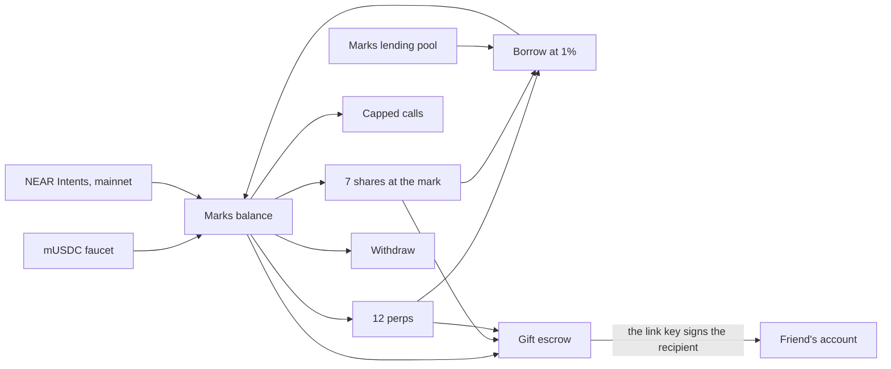
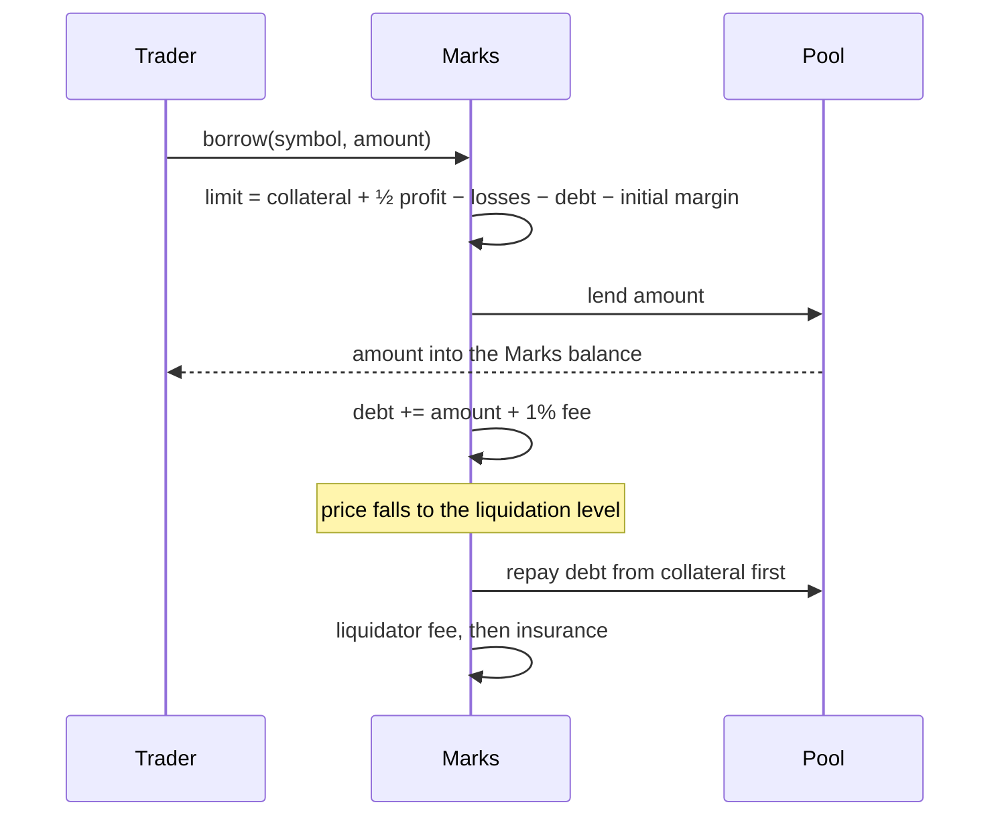
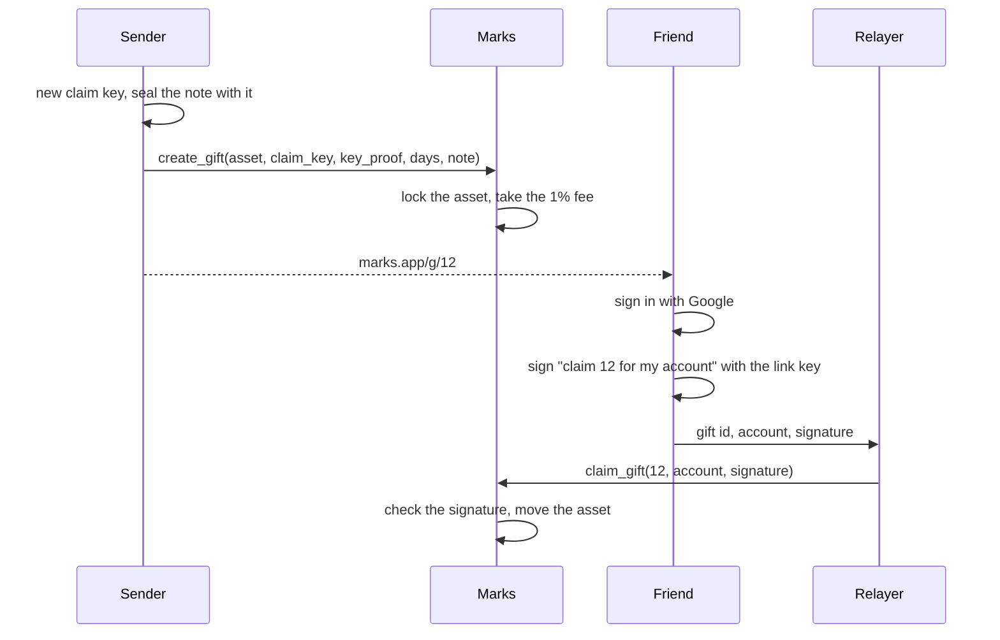
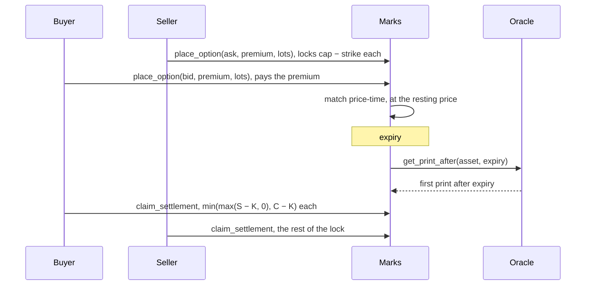
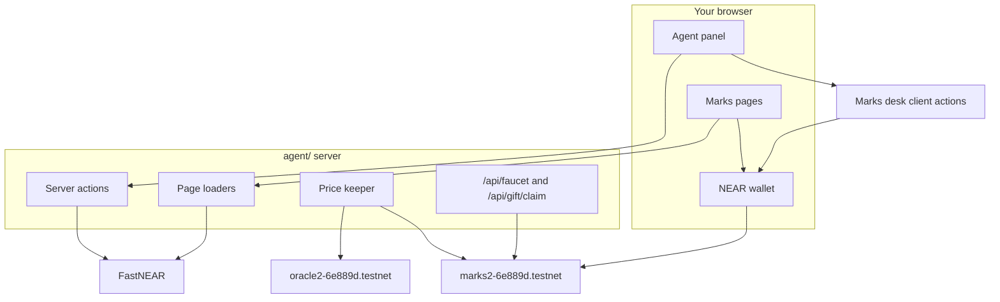
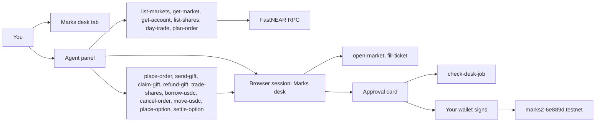

# Marks

**Trade perps and stocks on NEAR, borrow against what you hold, and give any of it away as a link.**

**[Live demo](https://marks.leash.market)** · **[NEAR testnet contract](https://testnet.nearblocks.io/address/marks2-6e889d.testnet)** · **[Transactions](#transactions)** · **[Run locally](#quick-start)**

Trading across perpetuals, tokenized stocks, lending and payments is fragmented across separate apps, while most AI market tools stop at advice and cannot safely execute an on-chain action. Marks puts those workflows on one desk and makes the person's wallet the final approval boundary.

Marks is an agent-native trading terminal on NEAR. Its agent researches any stock or token, analyzes markets, manages the person's portfolio and prepares trades. One NEAR contract holds a USDC balance per account and runs twelve perpetual order books, a desk that sells tokenized shares at the oracle price, capped calls with a fully paid worst case, and loans against perp positions or shares. Any share, USDC amount or whole open perp position can become a claim link.

NEAR is the settlement and account layer: contracts hold balances and positions, every state change is verifiable on testnet, transactions are fast and inexpensive, and the user approves agent-prepared writes with their own wallet. Gift recipients can use Google-backed NEAR accounts, while the claim relayer pays gas without gaining custody. Everything in the demo uses mock USDC on NEAR testnet.

## Quick start

Requirements: Node.js 22, pnpm 10.29.1, Rust stable with `rustfmt`, and Docker only if you want the production image. The live demo is the fastest way to test Marks; local development uses the same deployed testnet contracts.

```sh
git clone https://github.com/amdonatusprince/Marks-on-Near.git
cd Marks-on-Near
cp .env.example .env
ln -sfn ../.env agent/.env

npm ci
cd agent
corepack enable
corepack prepare pnpm@10.29.1 --activate
pnpm install --frozen-lockfile
MARKS_KEEPER=off pnpm dev
```

Open the URL printed by the command (`http://localhost:3000` when that port is free). The desk is public. Connect a testnet wallet to write, then press **Agent** and connect a model to use chat. Claim mock USDC from `/faucet`; no real funds are used. The local command disables the paid oracle keeper; production already keeps the shared testnet prices fresh.

For a fast, non-interactive verification:

```sh
npm run format:check
cd agent && pnpm typecheck && pnpm agent-native:doctor
cd ..
cargo test --manifest-path contract/Cargo.toml   # 75 tests
cargo test --manifest-path token/Cargo.toml      # 7 tests
cargo test --manifest-path oracle/Cargo.toml     # 4 tests
docker build --platform linux/amd64 -t marks .
```

The CI workflow runs Prettier, the app typecheck, Rust formatting and all 86 Rust tests on every push and pull request.

## Architecture



## Borrow against a position

The pool lends USDC against an open perp. The loan is added to the position's debt. Equity in every margin check is collateral plus open profit minus debt, so the position liquidates earlier when it carries a loan. Liquidation repays the pool before anything else.



Shares borrow the same way with `borrow_against`. The shares are locked, the loan can reach 50 percent of their value, and anyone can sell them to the desk once the debt passes 65 percent.

## Send a gift

The sender's browser makes a one-time ed25519 key. The public half and a proof go on chain with the asset. The secret half goes only into the link, after the `#`, which a browser never sends to a server.



The relayer pays gas and can change nothing: the signature covers the gift id and the recipient account. A copied signature pays nobody else. The sender can revoke an open gift at any time. After it expires, the same refund still works.

## Buy a capped call



Both sides are fully paid at the trade. There is no margin, no funding and no liquidation on a call.

## The math

USDC has 6 decimals inside the contract: `1000000` atoms are $1. One share unit is `1000000` units. Every fee is 1 percent, rounded up.

### Perp margin with debt

```
equity          = collateral + q × (mark − entry) − debt
initial margin  = |q| × mark × 10%
maintenance     = |q| × mark × 5%
borrow limit    = collateral + ½ × max(profit, 0) + min(profit, 0) − debt − initial margin
largest loan    = borrow limit / 1.01
liquidation     = (q × entry − (collateral − debt)) / (q × (1 − 5%))     for a long
```

Worked example on `SOL-PERP`, where one contract is 0.5 SOL and the mark is $47.87:

| Step                        | Value                                     |
| --------------------------- | ----------------------------------------- |
| Long 10 contracts at $47.87 | notional $478.70                          |
| Collateral                  | $100.00                                   |
| Initial margin              | $47.87                                    |
| Liquidation with no loan    | (478.70 − 100) / 9.5 = **$39.86**         |
| Borrow limit                | 100 − 47.87 = $52.13, largest loan $51.61 |
| Borrow $40, fee $0.40       | debt $40.40                               |
| Liquidation with the loan   | (478.70 − 59.60) / 9.5 = **$44.12**       |

The borrow page shows both liquidation prices before you confirm.

### Share loans

```
loan limit        = 50% × units × price
liquidatable when = debt > 65% × units × price
liquidation price = debt / (65% × units)
```

Lock 1 Nvidia share at $204.63 and borrow $50. The debt is $50.50 and the loan is liquidatable below $77.69. The caller of `liquidate_loan` sells the shares to the desk at the mark, the pool is repaid, the caller earns 1 percent of the sale, and the rest returns to the borrower.

### Capped calls

```
payout per contract = min(max(S − K, 0), C − K)
break-even          = K + premium
most the buyer loses  = premium
most the buyer makes  = C − K − premium
the seller locks      = C − K, and keeps the premium
```

An Apple call from $344 to $379 bought at $14: break-even $358, worst case $14, best case $21. Apple settling at $365 pays $21 back for a net $7.

### Fees

| Action                 | Fee                               | Paid to         |
| ---------------------- | --------------------------------- | --------------- |
| Borrow on a perp       | 1% of the loan, added to the debt | the fee account |
| Borrow on shares       | 1% of the loan, added to the debt | the fee account |
| Gift USDC or shares    | 1% of the value at the mark       | the fee account |
| Gift a perp position   | 1% of the position's equity       | the fee account |
| Perp liquidation       | 1% of closed notional             | the caller      |
| Share loan liquidation | 1% of the sale                    | the caller      |

### The mark

A print more than 25 percent away from the mark is held as pending. The mark moves once a second print lands within 1 percent of the pending one. One bad print changes nothing, and a real gap is followed after two.

## Gift security

The sender's browser makes a one-time ed25519 key. Marks stores the public half with the gift. The secret half is only in the link, after the `#`. A browser never sends that part of a URL to a server, so the server cannot claim the gift.

| Piece           | What Marks does with it                                                                                               |
| --------------- | --------------------------------------------------------------------------------------------------------------------- |
| `key_proof`     | Signs `marks-gift-register:{contract}:{sender}`. The key is bound to that sender and that contract.                   |
| `used_keys`     | A claim key can register one gift. A second use is refused.                                                           |
| Claim signature | Signs `marks-gift-claim:{contract}:{id}:{recipient}`. The contract checks it with `env::ed25519_verify`.              |
| Who can submit  | Anyone, including the relayer. The recipient account is inside the signature, so a copied signature pays nobody else. |
| The note        | Sealed with AES-GCM from an HKDF of the claim key, at most 512 bytes. Only the link can open it.                      |
| Revoke          | `cancel_gift` while the gift is open. The link stops working and the asset comes back. The 1% fee stays paid.         |
| After expiry    | `refund_gift` does the same return.                                                                                   |

A gift can be USDC, shares, or a whole open perp position. A position gift freezes that market for the sender until it is claimed or revoked. Resting orders are cancelled. `place_order`, `release`, `borrow` and a second gift are refused. Funding and liquidation still run, and a liquidated gift becomes void. On claim the whole account on that market, with position, entry, collateral, debt and funding snapshot, moves to the recipient, who must be flat on that market.

## Contracts

| Crate       | Account                                                                                  | What it is                                                                                                                                                      |
| ----------- | ---------------------------------------------------------------------------------------- | --------------------------------------------------------------------------------------------------------------------------------------------------------------- |
| `contract/` | [`marks2-6e889d.testnet`](https://testnet.nearblocks.io/address/marks2-6e889d.testnet)   | Marks v2: balances, perps, shares, calls, the lending pool and gifts. Also the fee account.                                                                     |
| `token/`    | [`musdc-6e889d.testnet`](https://testnet.nearblocks.io/address/musdc-6e889d.testnet)     | Marks mock USDC, `mUSDC`, 6 decimals. `faucet` mints 1,000 to any account once a day. The token account is also the treasury that funded the pool and the desk. |
| `oracle/`   | [`oracle2-6e889d.testnet`](https://testnet.nearblocks.io/address/oracle2-6e889d.testnet) | Demo price feed with public prices, a short history, and `get_print_after` for call settlement.                                                                 |

`t1-6e889d` to `t6-6e889d` are the six seed traders. The pool started with 100,000 mUSDC and the share desk with 100,000 mUSDC.

The contract has no admin and no pause. A perp, a share, a call series and the fee are fixed when they are created. The release build keeps overflow checks on.

### Public methods added in v2

| Method                                                                                                                                                                       | Effect                                                                          |
| ---------------------------------------------------------------------------------------------------------------------------------------------------------------------------- | ------------------------------------------------------------------------------- |
| `ft_on_transfer` with msg `""` / `"deposit"`, `"pool"` or `"desk"`                                                                                                           | Credits the Marks balance, the lending pool, or the share desk                  |
| `borrow`, `repay`                                                                                                                                                            | Perp loans against one market                                                   |
| `borrow_against`, `repay_share_loan`, `liquidate_loan`                                                                                                                       | Share loans                                                                     |
| `withdraw_supply`                                                                                                                                                            | A pool supplier takes back idle USDC it supplied                                |
| `list_share`, `refresh_share`, `buy_shares`, `sell_shares`                                                                                                                   | The share desk. A buy needs a price from the last hour. A sell always runs      |
| `list_series`, `place_option`, `cancel_option`, `settle_series`, `claim_settlement`                                                                                          | Capped calls                                                                    |
| `create_gift`, `claim_gift`, `cancel_gift`, `refund_gift`                                                                                                                    | Gifts. `cancel_gift` reclaims an open one. `refund_gift` does that after expiry |
| `get_pool`, `get_shares`, `get_holdings`, `get_share_loans`, `get_series_list`, `get_option_book`, `get_option_position`, `get_gift`, `get_gifts_sent`, `get_gifts_received` | Views                                                                           |

`get_trader` also returns `debt`, `borrow_limit` and `gift_id`. Events use NEP-297 with standard `marks`, version `2.0.0`.

### Transactions

Deploy, funding, and one live pass of every flow. The seed is a few hundred more fills on the [marks2 account](https://testnet.nearblocks.io/address/marks2-6e889d.testnet).

| Step                        | Transaction                                                                                      |
| --------------------------- | ------------------------------------------------------------------------------------------------ |
| Deploy mUSDC and `new`      | [FS9vY5DEwGNt…](https://testnet.nearblocks.io/txns/FS9vY5DEwGNtQUwpfSqSjd344YFZcKVvyc96zyRWtyut) |
| Deploy the oracle and `new` | [DWwAtQF7dc1Z…](https://testnet.nearblocks.io/txns/DWwAtQF7dc1ZnvJU5wiMWhYCEWCCbZpMv9DhqEyC3tkm) |
| Deploy Marks and `new`      | [AjoxcLWyDcS3…](https://testnet.nearblocks.io/txns/AjoxcLWyDcS3W85ZYvi3HDehNjbXfFFfb5Tk95XaZb1F) |
| First perp, NEAR-PERP       | [42V7WeiDW72V…](https://testnet.nearblocks.io/txns/42V7WeiDW72VsE8Szp9xRHE2ed1DHEriKQutg18wSn9A) |
| First share                 | [2GAQxHkGJa64…](https://testnet.nearblocks.io/txns/2GAQxHkGJa64zZfecQpguoLKFY78YME6NKEUDCxRxhZv) |
| First call series           | [GnJaaR6obnP1…](https://testnet.nearblocks.io/txns/GnJaaR6obnP1Vc5gVp9Jmr4CrNeTw6oFWNqoYsLz59u2) |
| Mint the treasury           | [G2Rch6ngWwYW…](https://testnet.nearblocks.io/txns/G2Rch6ngWwYWTpEUS55Pk8bctoK7KxPCVPn6KNBh37CZ) |
| Fund the pool, 100,000      | [58YVi62vdGwz…](https://testnet.nearblocks.io/txns/58YVi62vdGwzqwTK67ijk9uyda6YjJnbLA3VaqQAp3Qv) |
| Fund the desk, 100,000      | [7b8Xt8cX7zxY…](https://testnet.nearblocks.io/txns/7b8Xt8cX7zxYqwqSXGzqZX12vdZqarM66jze9svZgv52) |
| Faucet, 1,000 to t6         | [5NujBEyqZg42…](https://testnet.nearblocks.io/txns/5NujBEyqZg42QBYWYAjQTVdkkkkjyXtvnwVBBBJNeyJm) |
| Deposit into Marks          | [En9FupWh6AHi…](https://testnet.nearblocks.io/txns/En9FupWh6AHi1Lgb5WpGdcUuQSSiNupzQGZehgUCCTYM) |
| Buy Apple shares            | [9sYF9s8rFJzS…](https://testnet.nearblocks.io/txns/9sYF9s8rFJzSXdzEHMXVUpp7KJxRgMxg8482PbvF9chS) |
| Sell a tenth of a share     | [72q26QVGEkQk…](https://testnet.nearblocks.io/txns/72q26QVGEkQk9akWzZHCb6unZ6wEjh3zw2k6onnYTuV9) |
| Borrow against shares       | [FrqzpdJRWRHj…](https://testnet.nearblocks.io/txns/FrqzpdJRWRHjAZMTEds7crYfQSrvZN4TxH4hJ1eT5D36) |
| Repay part of that loan     | [BNwnN7ojiVMa…](https://testnet.nearblocks.io/txns/BNwnN7ojiVMa9MmNauWc3qacyUU75AKnPEzXwfFncMYH) |
| Borrow on SOL-PERP          | [BVVuA2uXcdTz…](https://testnet.nearblocks.io/txns/BVVuA2uXcdTzgA6mnD8ktpG1cwn6Sn98rFW2KGi31aLm) |
| Repay part of that loan     | [5KQZKQcabBdL…](https://testnet.nearblocks.io/txns/5KQZKQcabBdLMWBPstgePW449nuzxaRF6qQSK6jCZeHG) |
| Gift 25 mUSDC               | [8Pj3TBHnvShw…](https://testnet.nearblocks.io/txns/8Pj3TBHnvShwz7ruymjw8FFNWHN1VvM2EFGiZWAvsfWn) |
| Claim that gift             | [8U4ADvz7fU1Z…](https://testnet.nearblocks.io/txns/8U4ADvz7fU1Z5nSx46ePhdUg3ARYdMz9tCUWBNGiWgEP) |
| Gift a NEAR-PERP position   | [2KEvoh4v9dyz…](https://testnet.nearblocks.io/txns/2KEvoh4v9dyziwewEDYVcnw6yvBUQemm6aGAUoWvqn8m) |
| Claim that position         | [BZncTPTHP54T…](https://testnet.nearblocks.io/txns/BZncTPTHP54T3JbMtrz4DvwJq4cTvoPmi8h83NCbWUFT) |
| Buy one capped call         | [3dom23shNqkU…](https://testnet.nearblocks.io/txns/3dom23shNqkU9rsHP9C4yRT2qsnyGrbs3AyvjYyPGkCT) |

## Run it

```sh
cargo test --manifest-path contract/Cargo.toml   # 75 tests
cargo test --manifest-path token/Cargo.toml
cargo test --manifest-path oracle/Cargo.toml
npm run format:check
cd agent && pnpm typecheck && pnpm agent-native:doctor
```

Stand up v2 on new accounts, or resume a stage:

```sh
./scripts/v2.sh
./scripts/v2.sh --from-deploy | --from-feed | --from-list | --from-seed | --from-exercise
```

The v2 scripts sign through near-cli's `testnet-fastnear` connection. Set `NEAR_CLI_NETWORK` to use another one.

| Script                   | What it does                                                                                                                                                                  |
| ------------------------ | ----------------------------------------------------------------------------------------------------------------------------------------------------------------------------- |
| `scripts/v2-accounts.sh` | Creates the token, oracle, contract and six trader accounts. Writes them into `.env` under the same `VITE_*` names the app uses                                               |
| `scripts/v2-deploy.sh`   | Builds the three crates and calls `new` on any account that has no code yet                                                                                                   |
| `scripts/v2-feed.sh`     | Fetches public prices and stores them on the oracle                                                                                                                           |
| `scripts/v2-keep.sh`     | Restamp stale markets and shares every 30 minutes. The app server starts `--loop` on boot. Each refresh costs 0.02 NEAR                                                       |
| `scripts/v2-list.sh`     | Lists 12 perps, 7 shares and 14 call series, then funds the pool and the desk from the treasury                                                                               |
| `scripts/v2-seed.sh`     | 10 to 30 random fills per perp, 5 to 8 resting levels per side, and a quoted book on every series. Three workers sign with disjoint traders. `--options` seeds only the calls |
| `scripts/v2-exercise.sh` | Runs each flow once live: faucet, shares, both loans, a USDC gift, a position gift, a call                                                                                    |
| `scripts/v2-web-env.sh`  | Sets `VITE_CONTRACT_ID`, `VITE_ORACLE_ID` and `VITE_TOKEN_ID` in `.env`                                                                                                       |
| `scripts/relay.sh`       | What the app's relayer runs: `gift-claim` and `faucet`, signed by `AGENT_ID`                                                                                                  |
| `scripts/gift_keys.mjs`  | Makes a claim key and signs a claim from the shell                                                                                                                            |
| `scripts/web-check.mjs`  | Loads every page at 375, 768, 1024 and 1440 wide, reports sideways overflow and console errors                                                                                |

Keys stay in the macOS login keychain through near-cli. Account ids live in `.env` at the repo root. Copy `.env.example` to `.env`, then `ln -sfn ../.env agent/.env`.

## The app

Marks is one [Agent-Native](https://www.agent-native.com/docs/) app in `agent/` (React Router, Vite, Nitro). There is no second frontend. The desk pages, the relayer, the faucet, the price keeper, the wallets and the agent all run on that server. Page HTML is public and cached; loaders do not see who you are. Chain writes happen in the browser after you sign in with a NEAR wallet. The Agent panel is a second login (the Agent-Native session) sitting beside those pages.



Two sign-ins, on purpose:

1. **NEAR wallet** (Google via [NEAR Auth](https://docs.auth.near.org/), a passkey, or NEAR Connect: NEAR, EVM, Solana, Stellar, TON, Tron) so the contract can see an account. Google gets 0.05 NEAR for gas on first sign-in. This is what Place order, Send a gift and the agent's client actions use.
2. **Agent-Native session** so the Agent panel can open. Press **Agent** signed out and you land on that sign-in, then back on the same Marks page. Connect a model with **Use Builder.io** or a custom key.

See [Quick start](#quick-start) for a fresh checkout. Existing maintainers can run `./scripts/v2-web-env.sh`, then `cd agent && pnpm dev`.

| Path               | What it does                                                                                                                                                                                                             |
| ------------------ | ------------------------------------------------------------------------------------------------------------------------------------------------------------------------------------------------------------------------ |
| `/`                | Hero with the 3D envelope and a certificate that cycles through a 10x BTC long, a $500 loan and a $25 Nvidia gift, live ticker, how it works, the board                                                                  |
| `/markets`         | Every perp: price, funding, open interest, volume                                                                                                                                                                        |
| `/markets/:symbol` | Live candles at 1m, 15m, 1h and 1D, a live book, a ticket with the liquidation price, and "Borrow against this position". NEAR, SOL, ETH and BTC tick on every Coinbase trade. The other markets refresh every 4 seconds |
| `/stocks`          | Buy and sell shares, and a call picker with expiry, premium, break-even, worst case and best case                                                                                                                        |
| `/borrow`          | Perp and share loans, with the debt and the liquidation price before and after                                                                                                                                           |
| `/send`            | Send a share, USDC or a position, with a live certificate preview, the fee, the link, and every gift you sent                                                                                                            |
| `/g/:id`           | The claim page: envelope, certificate, Google sign-in, the sealed note                                                                                                                                                   |
| `/portfolio`       | Balances, positions, shares, loans, calls and gifts in one place                                                                                                                                                         |
| `/faucet`          | Claim 1,000 mUSDC and deposit it into Marks. Cross-chain Intents is quoted dry and is not live on testnet                                                                                                                |
| `/chat`            | Full-screen agent thread. Same tools as the side panel                                                                                                                                                                   |
| `/settings`        | Agent model and keys                                                                                                                                                                                                     |

The faucet and gift claims go through `/api/faucet` and `/api/gift/claim`, which run `scripts/relay.sh`, so a Google user claims both without gas. A wallet user signs the transaction in the wallet. Nightly would then broadcast it through its own node list, which rejects `send_tx` and retries until the transaction expires, so Marks broadcasts the signed transaction on FastNEAR instead. Candles are `/api/candles`. NEAR Auth fund and sign are `/api/near-auth`. The claim secret stays in the link. The browser that sent the gift keeps a copy, and after that wallet signs once, the same account can copy the link from another browser.

The app reads testnet through FastNEAR's RPC. Set `VITE_TESTNET_RPC` in `.env` to use another. The pages and the agent's chain reads use the same `VITE_CONTRACT_ID`, `VITE_TOKEN_ID` and `VITE_ORACLE_ID`. The server starts `./scripts/v2-keep.sh --loop` on boot so marks and shares stay inside the one-hour window. On a machine without the near-cli keychain it signs as `AGENT_ID` with `MARKS_KEEPER_KEY`. Set `MARKS_KEEPER_ACCOUNT` only when the keeper is a different account. `MARKS_KEEP_LEAD` is the age in seconds before a refresh, 1800 by default.

## Deploy

The production host is a Google Cloud `e2-micro` in `us-central1-a`, with a 30 GB standard persistent disk. The container is one long-lived process behind Caddy at [marks.leash.market](https://marks.leash.market). Publishing it does not move the contracts. Intents stays a dry quote.

Build the image on this Mac. The VM has 1 GB of RAM, which can run the server and cannot build the image.

```sh
docker build --platform linux/amd64 -t marks:latest .
docker save marks:latest | gzip > marks.tar.gz
```

Copy `marks.tar.gz` and `.env` to the VM. On the VM, install Docker, add 1 GB of swap, load the image, and start it. `.env` is the only thing you add. Leave `DATABASE_URL` empty.

```sh
sudo fallocate -l 1G /swapfile && sudo chmod 600 /swapfile && sudo mkswap /swapfile && sudo swapon /swapfile
gunzip -c marks.tar.gz | sudo docker load
sudo docker run -d --name marks --restart unless-stopped \
  -p 127.0.0.1:3000:3000 \
  -v marks-data:/marks/agent/data \
  --env-file /home/donatusprince/.env \
  marks:latest
```

On start the container reads `MARKS_KEEPER_KEY` and gives that key to `near-cli`, so the faucet, gift claims, and Google sign-in sign as `AGENT_ID`. The keeper uses the same key. Agent sign-in, chats, and gift links stay in the `marks-data` volume. Caddy owns public ports 80 and 443 and proxies to `127.0.0.1:3000`. The boot disk has to be a standard persistent disk. A balanced or SSD disk is billed, and outbound traffic past 1 GB in a month is billed.

`BETTER_AUTH_SECRET` is already in `.env`. A new value signs every agent session out. Wallet sign-in, gifts, and trades do not use it.

## The agent

Press **Agent** in the nav and the agent opens in a panel beside every page. It researches any stock or token through Yahoo-backed tools, says when a name is not listed on Marks, and reads the same chain as the pages before managing this account. What you can do on `/markets`, `/stocks`, `/borrow`, `/send`, `/faucet` and a gift claim page, you can ask for in chat. Before anything is signed, Marks shows an approval card in the tab. Then your own wallet signs. The agent never holds a wallet key.

Reads go through server actions (`agent/actions/`, FastNEAR RPC). Writes are typed server actions too, and each one runs the client action of the same name on your Marks tab (`agent/app/marks/lib/desk-actions.ts`), which calls the same function as the page button (`agent/app/marks/lib/desk-writes.ts`). `send-gift` calls `agent/app/marks/lib/create-gift.ts`, the same `create_gift` path as `/send`. The returned link keeps the secret after the `#`. `plan-order` imports `agent/app/marks/lib/order-plan.ts`, the same math as the ticket.

A write puts an approval card in the tab. Press **Open wallet** and sign. The agent waits with `check-desk-job` and replies with the transaction link once the wallet returns. Balances, positions, shares, loans and gifts re-read automatically after the write lands. Before a card appears, the server checks the contract's rules, so the agent tells you up front when a gift is already closed or when a loan is over the limit. For a share loan it locks the fewest shares that keep debt plus the 1% fee within 50% of their value. `get-account` lists each resting order's id, so "cancel my order" works without looking it up.



| Page               | What you ask in chat                     | Action                                                                                                                                         |
| ------------------ | ---------------------------------------- | ---------------------------------------------------------------------------------------------------------------------------------------------- |
| `/markets/:symbol` | Plan and place a perp                    | `plan-order`, then `place-order`. `fill-ticket` fills the ticket without placing. `open-market` moves the desk. `cancel-order` cancels a rest. |
| `/stocks`          | Buy or sell a share                      | `list-shares`, then `trade-shares`                                                                                                             |
| `/stocks`          | Buy, write or settle a call              | `list-shares`, then `place-option` or `settle-option`                                                                                          |
| `/borrow`          | Borrow or repay against a perp or shares | `borrow-usdc`                                                                                                                                  |
| `/send`            | Gift USDC, shares or a position          | `send-gift`. The chat returns the claim link. `refund-gift` revokes an open one. The link stops working.                                       |
| `/g/:id`           | Open the gift in the current link        | `claim-gift`. The secret stays in the URL hash and the recipient account is bound into the claim signature.                                    |
| `/faucet`          | Claim 1,000 mUSDC, deposit or withdraw   | `move-usdc`                                                                                                                                    |
| `/portfolio`       | How this account is doing                | `get-account` (balances, positions, shares, gifts sent, no claim secrets)                                                                      |

The panel is the Agent-Native `AgentSidebar` in the Marks layout. The tab registers itself as a browser session named "Marks desk". The full chat is at `/chat` and settings at `/settings`.

```sh
cd agent && pnpm dev   # http://localhost:3000, press Agent
cd agent && pnpm action list-markets
cd agent && pnpm action list-shares --assetId nvda
cd agent && pnpm action plan-order --accountId you.testnet --symbol SOL-PERP --side long --amount 300
```

The Marks pages are public. Pressing **Agent** signed out goes to the agent sign-in and returns to the same page. Connect a model once in the panel with **Use Builder.io**, or add a provider key under Custom keys. Client actions run in the open Marks tab, so a gift, a trade or a loan needs that tab signed in with a wallet.

## Limits

- **Shares are Marks ledger entries on testnet.** A share is a balance inside the contract, bought and sold at the oracle price against a desk funded with mUSDC. No share of Apple or Nvidia stands behind it.
- **Intents runs on mainnet only.** It is how a deposit arrives from another chain and how a withdrawal leaves. `scripts/intents-quote.sh` asks 1Click for a dry quote and does not send funds.
- **Prices gap over weekends.** Stock and metal prints stop when their markets close. A share buy and a perp order that adds risk wait for a print from the last hour. The two-print rule follows a Monday gap after two agreeing prints, and liquidations then run at the new mark.
- **A call settles on the first print after expiry.** A series that expires over a weekend settles on Monday's first print.
- **A position gift can be liquidated before it is claimed.** The gift becomes void and the fee stays spent.
- **The relayer can delay a claim and nothing more.** Anyone can submit a signed claim, including the recipient's own account.
- **Chat cannot write until both logins are done.** The Marks tab must have a NEAR wallet, and the Agent panel must have an Agent-Native session and a model. Reads still work from the server actions with only the account id.
