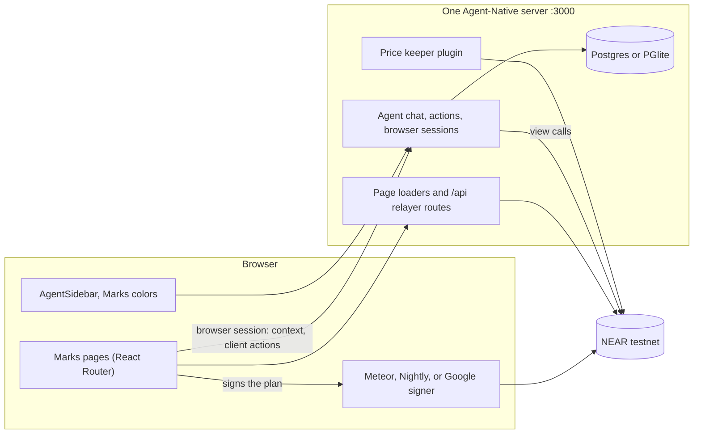

# Marks on Agent-Native: the build plan

Goal: a person and an agent trade on the same Marks desk, from the same actions, on the same NEAR account. This is the entry for the [Agent-Native Hackathon](https://www.builder.io/hackathon). Submissions close **Monday 9 November 2026, 11:59 PM PT** (10 November, 08:59 in Lagos). The entry needs a working app built with Agent-Native, a public Clips demo, and a note on what existed before 27 October and what changed during the event.

Checked against `@agent-native/core@0.223.0` (the current `latest`) and a scaffolded chat template, on 3 November 2026.

## What the judges score, and how Marks answers it

| Criterion                       | Weight | Marks answer                                                                                                                                                                           |
| ------------------------------- | ------ | -------------------------------------------------------------------------------------------------------------------------------------------------------------------------------------- |
| Usefulness and execution        | 40%    | A real perps, shares, borrow, and gift desk on testnet. The agent reads the account, plans the order, fills the ticket, and the person signs once.                                     |
| Creativity and design           | 20%    | The agent fills the same ticket a person uses, on screen, before the wallet opens. The sidebar matches the Marks palette.                                                              |
| Innovation                      | 20%    | The agent does the work people get wrong: stale marks, margin from the Marks balance, liquidation distance. Watches keep running after the tab closes.                                 |
| Cleverness and Agent-Native use | 20%    | One `plan-order` action serves the ticket button, the chat, the CLI, and MCP. Host client actions, browser sessions, application state, approvals, a SQL journal, and a recurring job. |

## Architecture

Three decisions hold the plan together.

1. **Marks is the Agent-Native app.** Every Marks page, the relayer and faucet routes, the keeper and the wallets live in `marks/agent/`, built from the official chat template. The pages are React Router routes with loaders, the API routes are Nitro handlers, and the keeper is a Nitro plugin. `web/` is retired.

2. **One origin, one codebase.** The `AgentSidebar` from `@agent-native/toolkit` wraps the Marks layout, so the panel opens beside every page. The desk registers itself as a browser session in the same origin, and the agent's built-in browser-session tools run its client actions. The Marks pages stay public and server-rendered. The agent asks for its own sign-in.

3. **The chain is the record and the wallet is the signer.** Backend actions read NEAR views and return a transaction plan. The only thing that sends a transaction is a client action in the desk, which opens the existing wallet. The agent never holds a key.

## The shared action layer

One planner, written once, used by every surface.

| Action                         | Kind                 | Who calls it                      | What it does                                                                                                                                                  |
| ------------------------------ | -------------------- | --------------------------------- | ------------------------------------------------------------------------------------------------------------------------------------------------------------- |
| `list-markets`                 | backend, read        | agent, CLI, MCP, market board     | `get_markets` with mark, age in seconds, and stale flag.                                                                                                      |
| `get-market`                   | backend, read        | agent, CLI, MCP                   | One market, its book depth, and recent candles from `/api/candles`.                                                                                           |
| `get-account`                  | backend, read        | agent, CLI, MCP                   | `get_trader` for the signed-in account: Marks balance, collateral per market, positions, orders, liquidation price, loans, shares, calls, gifts.              |
| `plan-order`                   | backend, read        | **order ticket**, agent, CLI, MCP | The ticket's logic moved here: fresh-mark check, `marginShortfall`, and the exact `commit` plus `place_order` calls. Returns the plan, cost, and any refusal. |
| `plan-cancel`                  | backend, read        | agent, CLI, MCP                   | The `cancel_order` call for an order id the account owns.                                                                                                     |
| `plan-shares`                  | backend, read        | stocks desk, agent                | `buy_shares` or `sell_shares` from an amount.                                                                                                                 |
| `record-trade`                 | backend, write       | host after a signature            | Writes a journal row. Reads the transaction status from NEAR before saving, so a row means it executed.                                                       |
| `list-journal`                 | backend, read        | portfolio page, agent             | Trades on this account, tagged person or agent, with the transaction hash.                                                                                    |
| `create-watch`                 | backend, write       | agent, portfolio page             | A price or margin watch on a market. Stored in SQL.                                                                                                           |
| `list-watches`, `delete-watch` | backend              | agent, portfolio page             | Manage watches.                                                                                                                                               |
| `view-screen`, `navigate`      | template             | agent                             | Kept from the template, extended with the Marks route and symbol.                                                                                             |
| `fill-ticket`                  | **client**           | agent through the live tab        | Sets side, price, and amount on the open ticket so the person sees the order before signing.                                                                  |
| `sign-plan`                    | **client**, approval | agent through the live tab        | Shows the approval, then sends the plan through `sendMany`. Returns the transaction hash. Refreshes the account panel.                                        |
| `open-market`                  | **client**           | agent through the live tab        | `router.push('/markets/SYMBOL')`.                                                                                                                             |

The pure logic lives in `marks/agent/app/marks/lib/`: `cover.ts` (unchanged math), `order-plan.ts` with mark freshness and the call builders, and `place-order.ts`. The desk and the agent actions both import it, so the ticket and the chat cannot drift. The order ticket then calls `plan-order` over `/_agent-native/actions/plan-order`, the same route the agent uses.

## One trade, end to end

1. The person opens SOL-PERP and toggles the agent in the nav. The desk sends context: route `market`, symbol `SOL-PERP`, account id, and the ticket draft.
2. They type "long 3 contracts near the mark."
3. The agent calls `get-market` and `get-account`, then `plan-order`. The plan says the mark is 52 minutes old, a refresh costs 0.02 NEAR, and the order needs a 20.69 mUSDC commit from the Marks balance.
4. The agent calls `fill-ticket`. The ticket on screen shows Buy, the price, and the amount.
5. The agent calls `sign-plan`. The desk shows the approval with the calls and the cost. The person approves, and the wallet opens for the refresh, then for the order.
6. The desk calls `record-trade` with the hash. The account panel and the chat both show the new position. The journal row is tagged agent.

The person can also press Place order on the same ticket. That path calls the same `plan-order` and writes a journal row tagged person.

## Identity

Marks users are NEAR accounts, not emails. The agent app keeps Better Auth from the template and adds `getAdditionalSession` and `getAdditionalBrowserSession` (both in `AuthOptions`).

1. When the sidebar opens, the desk asks the wallet to sign a NEP-413 message containing a nonce from `POST /agent/api/near-session/nonce`.
2. `POST /agent/api/near-session` verifies the signature and checks the public key against `view_access_key` for that account on FastNEAR. It sets an HttpOnly, SameSite=Lax cookie signed with `MARKS_SESSION_SECRET`, valid for 12 hours.
3. `getAdditionalSession` reads that cookie and returns `{ userId: accountId, name: accountId }`. Threads, journal rows, and watches are owned by the account.

Signed out, the sidebar still opens and the read actions over public markets still work. Account actions return a sign-in prompt.

## Watches: the agent's job when the tab is closed

`create-watch` stores a rule: a mark above or below a price, or a position's margin ratio within a set distance of maintenance. A recurring job (`@agent-native/core/jobs`) runs every five minutes, reads the chain, and writes a notification and a chat message on the account's thread when a watch fires. A watch never trades. It tells the person and links to the pre-filled ticket.

The mark keeper stays its own process. It is not part of the agent, and its key does not move.

## Order of work

Each step ends with a check. A step is not finished if a call returns placeholder data.

### Step 1. The agent app runs on its own (3 Nov)

- Scaffold `marks/agent/` from `@agent-native/core@0.223.0 --template chat --standalone`. Name it `marks-agent`. pnpm, Node 22.22 or later.
- Check: `pnpm dev`, open `/chat`, ask the `hello` action for a reply.

### Step 2. Marks moves into the agent app (3 Nov)

- Copy the Marks components and libraries into `app/marks/`, and replace `next/link`, `next/navigation`, `next/dynamic`, `next/font` and `NEXT_PUBLIC_*` with React Router, `React.lazy`, Fontsource and `VITE_*`.
- One route per page with a loader. Loaders read the default network, since the page HTML is one shared CDN copy, and the visitor's network choice applies after hydration. Chain routes shorten the cache to 5 seconds.
- The relayer, faucet, candles and quote routes as Nitro handlers under `/api`, public in the auth guard. The keeper as a Nitro plugin.
- The Marks palette drives the template's HSL tokens, so the sidebar, chat and settings wear the Marks colors.
- Check: the hero, the scroll pin, and every page render at 375 and 1440 px, and the agent fills the SOL-PERP ticket through the browser session.

### Step 3. Identity (4 Nov)

- Nonce and session routes in the agent app, NEP-413 verification, and the HttpOnly cookie.
- `signMessage` in `app/marks/lib/near.tsx` for Meteor, Nightly, and the Google key.
- Check: a signed-in account's id shows in `view-screen`. A forged cookie returns no session.

### Step 4. Shared desk logic and read actions (4 to 5 Nov)

- Unit tests for `cover.ts`, freshness, and the call builders in `app/marks/lib/`, from the current margin test cases.
- Add `list-markets`, `get-market`, `get-account`, and `plan-order`, plus `plan-cancel` and `plan-shares`.
- Switch the order ticket to `plan-order`. No behavior change.
- Check: the same shortfall as today for collateral 60000, 3 lots, order 50 000 000 at mark 47 870 000, which is 20 691 000. `pnpm action plan-order` and the ticket agree.

### Step 5. Client actions and the signed trade (5 Nov)

- `fill-ticket`, `open-market`, and `sign-plan` in the desk, with `destructive: true` and approval on `sign-plan`.
- `record-trade` and `list-journal` with a Drizzle table `trades`.
- Check on testnet: a chat-driven SOL-PERP order lands, the position shows, and the journal row is tagged agent. A ticket-driven order lands and is tagged person.

### Step 6. Instructions, skill, and the rest of the writes (6 Nov)

- `AGENTS.md`: what Marks is, the testnet mUSDC and NEAR fee facts, the rule never to invent a price, and the action index.
- `.agents/skills/trade-on-marks/SKILL.md`: initial margin, the Marks balance versus margin, the 25% jump rule, the one-hour stale window, and confirming a fill by reading the account.
- Cancel and shares through the same plan and sign path.
- Check: the agent refuses an order the Marks balance cannot cover, before the wallet opens.

### Step 7. Watches and MCP (7 Nov)

- `create-watch`, `list-watches`, `delete-watch`, the five-minute job, and notifications.
- A small Watches list on the portfolio page that calls the same actions.
- Turn on MCP for the read and plan actions. `sign-plan` exists only in the live tab, so an external client can plan and cannot send.
- Check: a watch fires once on testnet, and Cursor lists the Marks tools over MCP.

### Step 8. CI, README, and deploy (8 Nov)

- CI gains an agent job: `pnpm install --frozen-lockfile`, `pnpm typecheck`, `pnpm agent-native:doctor`, and the `app/marks/lib` tests. Root Prettier ignores `agent/.generated`.
- README: the agent section, one diagram, the action table, and run instructions.
- Deploy the one server on a long-lived host. Leave `DATABASE_URL` empty. The agent file at `agent/data/pglite` is the database, so that directory has to stay with the process. Env lives in the repo root `.env`: `ANTHROPIC_API_KEY` or a Builder.io connection, `BETTER_AUTH_SECRET` for `pnpm start`, plus the keeper key. A host that freezes after each request cannot run the keeper loop or the near-cli relayer.
- Check: the deployed URL completes the end-to-end trade.

### Step 9. Demo and submission (9 Nov)

- A public Clips recording, about three minutes: the toggle, the agent planning a stale-mark order, the ticket filling itself, one signature, the journal, a watch, and then the same trade done by hand from the same ticket.
- Submission text, truthful: Marks v1 began on 30 October. The move of Marks into `agent/`, the sidebar, the agent actions, identity, journal, and watches were built for this entry. Submit early and confirm receipt.

## What does not change

- The contracts. No redeploy, and `panic=abort` stays.
- The hero, its copy, and the scroll pin.
- The keeper and its key. The key lives in the gitignored root `.env`.
- Nightly's sign-then-FastNEAR-broadcast path. `sign-plan` reuses `sendMany` unchanged.
- Every page works signed out of the agent. The ticket plans through the shared module, the same code the action wraps, not a second copy.

## Risks to clear early

| Risk                                                | When it shows | Answer                                                                                     |
| --------------------------------------------------- | ------------- | ------------------------------------------------------------------------------------------ |
| React 19.3 breaks three.js or the Nightly connector | Step 2        | Run the hero, every page, and all three wallets before going further.                      |
| A wallet does not support NEP-413 signing           | Step 3        | That wallet gets read-only chat. Trading still works from the desk.                        |
| No model key, or credits run out                    | Step 1        | `ANTHROPIC_API_KEY` set on day one. A Builder.io connection is the documented alternative. |
| Testnet RPC rate limits during the demo             | Steps 5 and 9 | FastNEAR first, the same retry the keeper uses, and a dry run before recording.            |

## Needed from you

- An Anthropic key, or a Builder.io connection, for the agent.
- A testnet account with a Marks balance for the demo. sournook3216.testnet works once its faucet cooldown ends.
- The deploy host. Any long-lived Node host with Postgres works, and Railway or Render is the shortest path.
